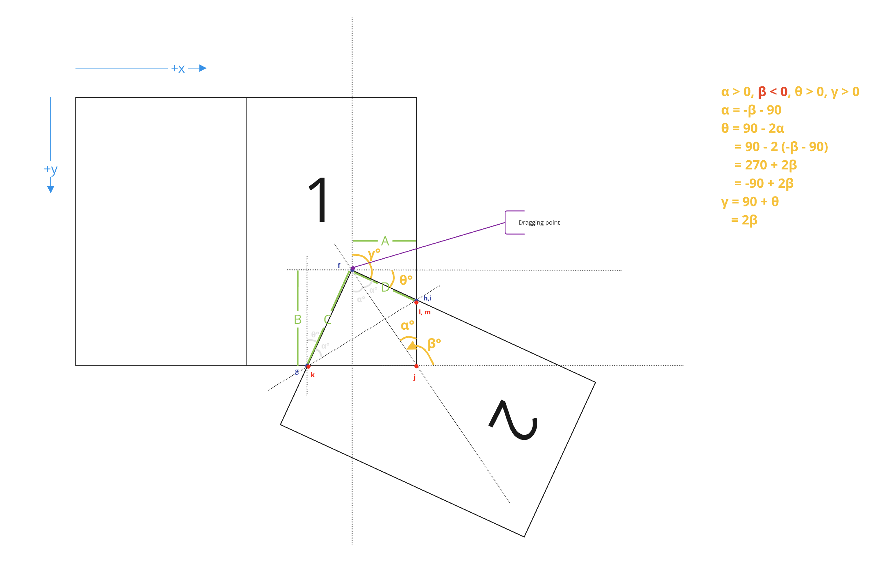
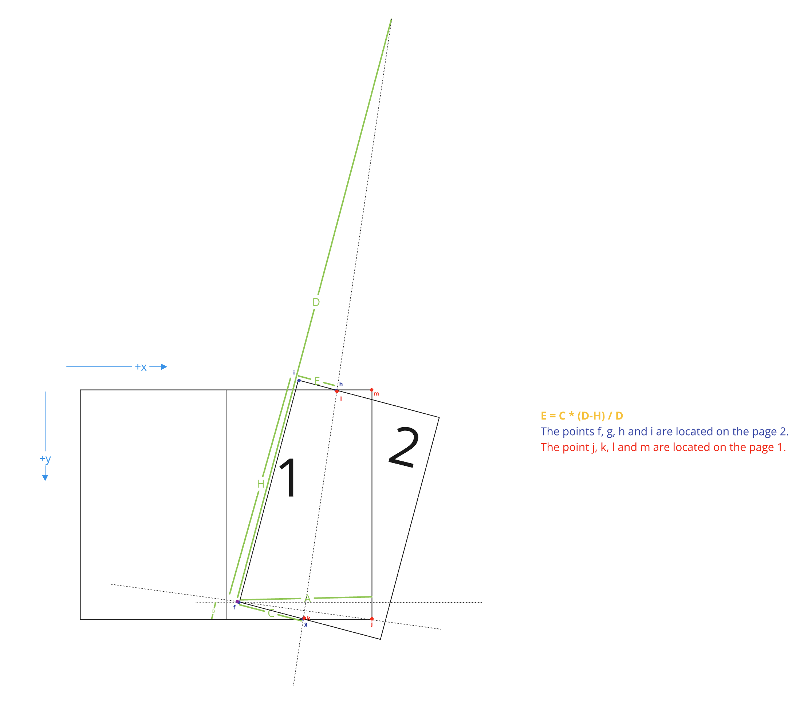
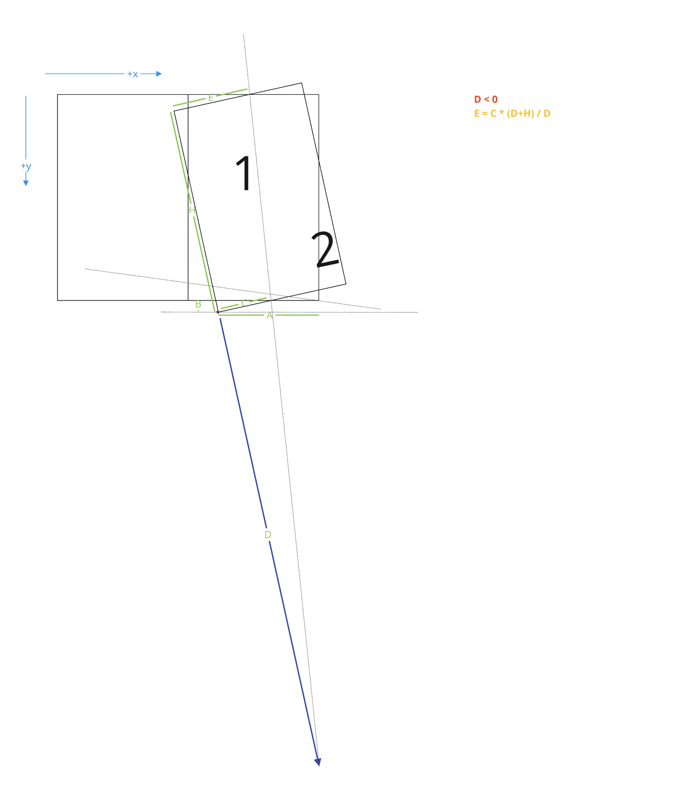
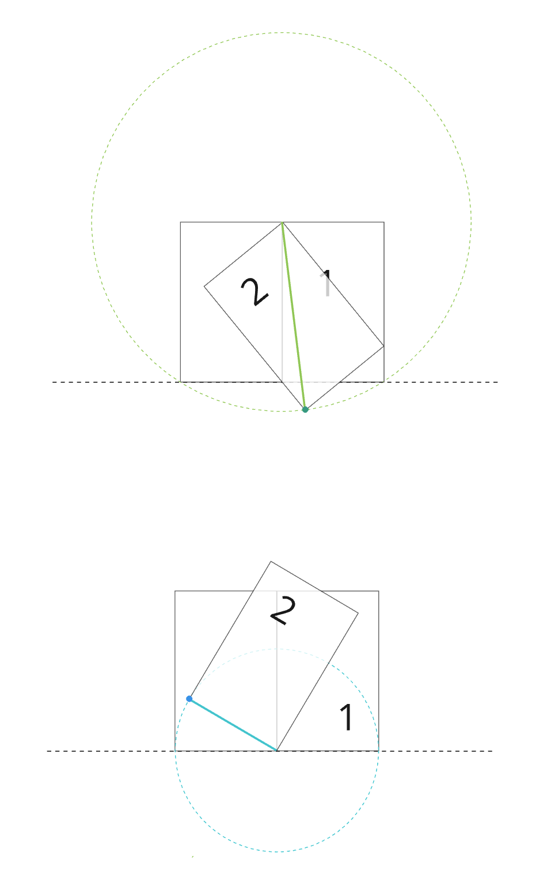
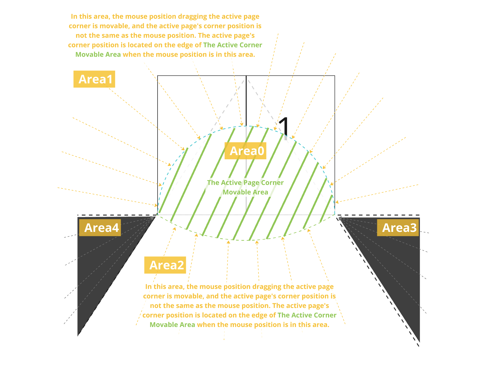
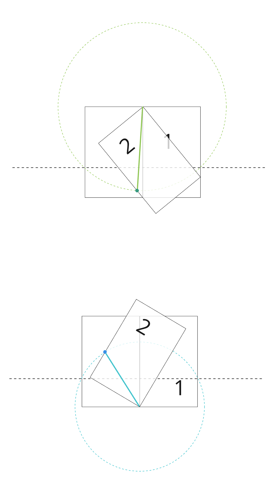
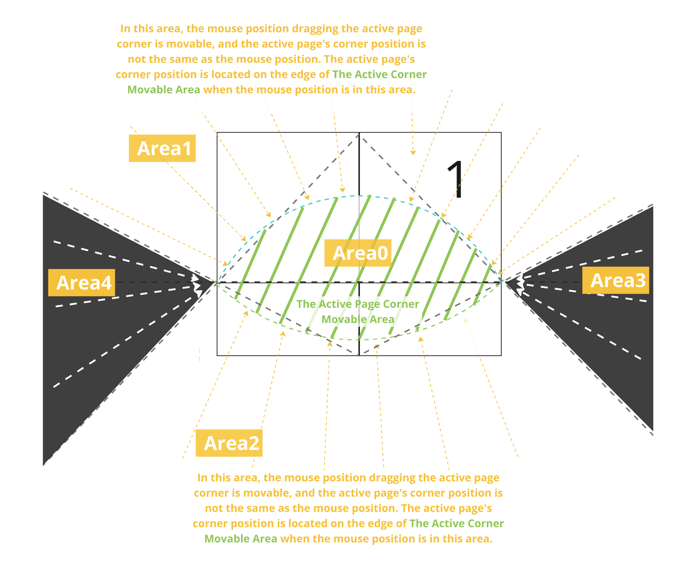

# MagFlip 
***<span style="color:yellow">MagFlip</span>*** is *<u>Magzog</u>'s first open project, implementing a page-flipping effect for books.
See [demo #1](https://magzogs.github.io/magFlip/examples/prebuild/magflip.html).
[demo #2](https://magzogs.github.io/magFlip/examples/react-ts/dist/index.html).

<span style="color:#888888">[*] "<u>Magzog</u> is a blend of 'magazine' and 'blog.' The idea is to combine printed formats like books, magazines, and newspapers with digital features."</span>


## Usage

### JavaScript module
The first step is to install the `core` and `flipview` packages:
```bash
npm install --save-dev @magflip/core @magflip/flipview
```
<span style="color: red; font-weight: bold;">[In Progress]</span> Then install any additional view plugins you plan to use:
```bash
npm install --save-dev @magflip/scrollview
```
<br>

### Pre-built browser ready bundle
Include the following lines of code in the `<head>` section of your page:<br>
Please refer to the [sample code](./docs/examples/prebuild) for more details.
```html
<script src="https://cdn.jsdelivr.net/npm/@magflip/minjs@0.5.48/magflip.min.js"></script>
```

<br>
<br>

## Documentation
The guides live in [`guide/`](./guide) (Markdown, rendered by a Docusaurus docs site).

| Guide | Path | For |
| --- | --- | --- |
| User Guide | [`guide/user`](./guide/user) | People who use MagFlip in their web pages |
| Developer Guide | [`guide/dev`](./guide/dev) | People who develop MagFlip itself (architecture, document model, flip math, build & release) |

<br>

## Local development
```bash
npm install
npm run build:local    # build all packages WITHOUT bumping versions (npm run build bumps patch versions)
npm test               # unit tests
npm run typecheck
npm run serve          # http://localhost:8190/docs/examples/local/
```

<br>
<br>

## Flip Effect in math




<br>
<br>

## The location of the mouse cursor



