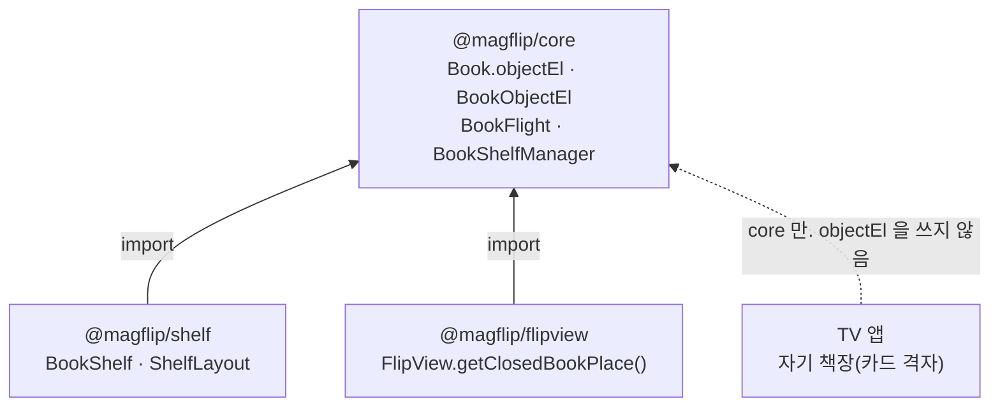
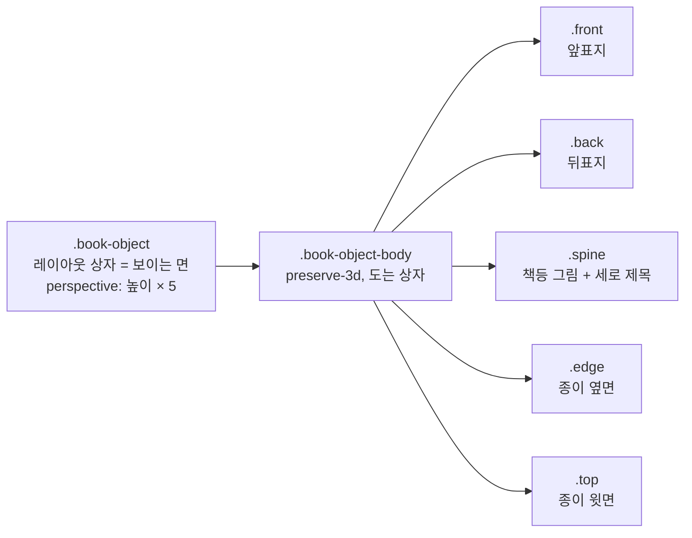
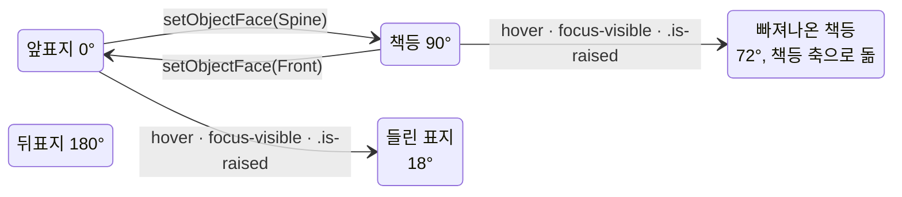
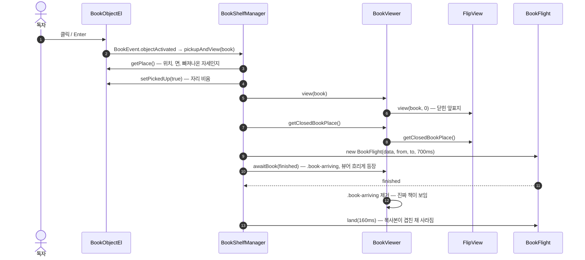

# 책 객체와 `@magflip/shelf`

독자가 책을 고르는 화면의 내부입니다. 사용법은 [책 고르기 (격자·책장)](../user/guides/bookshelf.mdx).

## 나누는 기준

**core 에는 책 한 권에 대한 것만 둡니다.** 여러 권을 늘어놓는 배치(격자, 책장)는 화면마다 다르므로 core 밖의 `@magflip/shelf` 가 맡습니다.

| 어디 | 무엇 | 파일 |
| --- | --- | --- |
| core | 책 한 권의 모습: 표지·책등(제목)·두께, 서 있는 면 | `core/bookObjectEl.ts`, `core/bookObject.css` |
| core | 호버·키보드 포커스로 빠져나온 자세 | `common/bookObjectMetrics.ts` `getBookPose`, `bookObject.css` |
| core | 열고 닫을 때 제자리 ↔ 뷰어로 날아가기 | `common/flightPath.ts`, `core/bookFlight.ts`, `BookShelfManager`, `BookViewer` |
| core | 뷰가 닫힌 책을 어디에 보여 주는지 | `IBookView.getClosedBookPlace?()` (FlipView 가 구현) |
| shelf | 격자·책장 배치, 선반, 전환, 가장 큰 책 기준 높이 | `shelf/src/bookShelf.ts`, `shelf/src/shelf.css` |

## 책 객체 (`BookObjectEl`)

`book.objectEl` 은 **처음 요구할 때** 만들어집니다(페이지 요소와 같은 방식). 책을 읽기만 하는 곳(TV)은 요소도, 표지 그림 요청도 만들지 않습니다. 이미 있는지는 `book.hasObjectEl` 로 봅니다.

- 크기는 CSS 변수로만 정합니다. 높이 `--mf-book-height` 는 놓는 쪽이, 비율 `--mf-book-aspect`·두께 `--mf-book-spine`·디자인 높이 `--mf-book-trim-height` 는 책이 `setSize()` 로 씁니다. 너비·두께는 `calc()` 로 높이에서 나옵니다.
- 두께 비율은 `getSpineRatio(pageCount)` — 최소 `MIN_SPINE_RATIO`(0.14, 제목이 읽히는 두께), 쪽마다 `SPINE_RATIO_PER_PAGE`(0.001), 최대 `MAX_SPINE_RATIO`(0.3). 실제 종이보다 훨씬 두꺼워서 두꺼운 책과 얇은 책이 한눈에 구별됩니다.
- **레이아웃 상자가 보이는 면입니다.** 책등이 보이면 너비가 두께, 표지가 보이면 너비가 표지 너비입니다. 면을 바꾸면 너비와 회전이 같이 바뀌며(`transition`), 옆 책들이 자연스럽게 밀립니다.
- **포인터를 받는 것도 레이아웃 상자(책이 꽂힌 자리)뿐입니다.** 도는 몸체 `.book-object-body` 는 `pointer-events: none` 입니다. 빠져나온 책등은 앞표지를 오른쪽으로 펼쳐 옆 책 몇 권을 덮는데, 표지가 포인터를 받으면 오른쪽으로 옮겨도 덮인 책들은 반응하지 않고 빠져나온 책만 계속 올라와 있습니다(왼쪽으로 옮길 때는 덮이지 않아 문제가 없었습니다). 자리는 움직이지 않으므로, 책이 움직여 포인터 밑을 벗어나는 떨림도 없습니다.
- 제목 글자 크기는 `min(두께 × .5, 높이 × .07)` 로 **책 크기에만 비례**합니다. px 로 최소·최대를 두면, 크게 그린 뒤 줄여서 나는 비행 복사본의 제목 크기가 원본과 달라집니다.
- 그림이 비었거나 못 불러오면 `.no-image` 가 붙고, 제목에서 정한 색(`--mf-book-color`, 12가지 색상) 위에 제목을 씁니다.
- 누르기(클릭·`Enter`·`Space`)는 `BookEvent.objectActivated` 를 내고, 책을 가진 `BookShelfManager` 가 `pickupAndView` 로 엽니다. core 가 책 한 권의 "누르면 열림"까지 책임지므로, 늘어놓는 쪽은 클릭을 연결하지 않습니다.

### 자세

모든 자세는 `translate3d(x, 0, z) rotateY(각도)` 한 가지 모양으로 씁니다. 함수 목록이 같아야 브라우저가 자세 사이를 부드럽게 옮깁니다. 숫자는 `getBookPose()` 와 `bookObject.css` 가 같습니다.

| 자세 | x | z (앞이 +) | 각도 |
| --- | --- | --- | --- |
| 앞표지 | 0 | −두께/2 | 0° |
| 책등 | 0 | −너비/2 | 90° |
| 빠져나온 책등 | 너비/2 · sin 18° | −너비/2 · cos 18° + 높이 × .14 | 72° |
| 들린 표지 | 0 | −두께/2 + 높이 × .14 | 18° |

상자 가운데를 축으로 72° 돌리면 책등이 옆으로 밀려 **왼쪽 책 위로 올라갑니다**. 그래서 빠져나온 책등은 옆으로 `너비/2 · sin 18°` 만큼 되돌려, 책등을 축으로 돈 것과 같게 만듭니다. 책등은 제자리에서 앞으로만 나오고 앞표지가 오른쪽으로 펼쳐집니다(`__tests__/bookObjectMetrics.test.ts` 가 이 위치를 검증합니다).

## 비행

책을 누르면 **책 자체가 아니라 복사본**(`BookFlight`)이 날아갑니다. 원본은 자리를 비운 채(`.is-picked-up`, `visibility: hidden`) 남아 있으므로 레이아웃이 흔들리지 않고, 돌아올 자리도 그대로 남습니다.

- **경로** (`getFlightPath`): 프레임 세 개. 출발 → 떨어져 나옴(30% 시점, 거리는 18%만, 앞으로 높이 × .35) → 도착. 먼저 독자 쪽으로 빠져나온 뒤 날아가서, 책장에서 꺼내는 느낌이 납니다.
- **크기**: 복사본은 두 끝 중 **큰 쪽 높이**로 그리고 `scale` 로 줄입니다. 키우는 일이 없으므로 그림이 흐려지지 않습니다.
- **출발 자세**: 원본이 빠져나온 자세(호버·포커스)였다면 그 자세에서 출발합니다(`isRaised`). 첫 프레임에서 복사본과 원본이 정확히 겹칩니다.
- **그림**: 복사본의 그림은 `decoding: sync`, lazy 아님. 원본에 이미 떠 있던 그림이라 캐시에서 첫 프레임에 그려집니다(`async` 면 첫 프레임에 바탕색이 비칩니다).
- **도착**: 표지 자리는 뷰가 알려 줍니다(`getClosedBookPlace`). FlipView 는 닫힌 상태면 `.book` 전체를, 펼친 상태면 **오른쪽 페이지 자리**를 앞표지로 돌려줍니다(닫으면 거기에 놓이므로). 끝에 닫혀 있으면 뒤표지로, 비행은 180° 에서 시작합니다.
- 이 메서드가 없는 뷰(ScrollView)나 화면에 놓이지 않은 책(TV)은 날지 않고 바로 엽니다.

닫을 때는 반대입니다. `BookViewer.closeViewer()` 가 **책을 떼어 내기 전에** `getClosedBookPlace()` 를 재 두고, 뷰어를 300ms 동안 흐리게 사라지게 하며(`.is-closing`, 그동안 클릭은 뒤로 통과), `returnBookToShelf(book, place)` 가 복사본을 550ms 동안 제자리로 날립니다. 내려앉으면 `setPickedUp(false)` 로 원본이 다시 보이고, 떠날 때 포커스를 가지고 있었다면 포커스도 돌려받습니다.

### 엉킴 막기

| 상황 | 처리 |
| --- | --- |
| 날아오는 중에 닫음 | 매니저가 들고 있는 비행을 `cancel()` 하고, 그 자리에서 돌아가는 비행을 시작 |
| 돌아가는 중에 다른 책을 엶 | 돌아가던 비행을 `cancel()`. `finished` 는 실패하지 않으므로 후처리가 돌고, 그 책은 `status` 가 `Close` 일 때만 자리를 되찾습니다 |
| 사라지는 중인 뷰어를 다시 엶 | `view()` 가 사라지는 애니메이션을 취소 |
| 뷰어 사라짐의 끝 | `fill: forwards` 로 투명하게 붙잡아 둔 채 `hidden` 을 붙이고 나서 애니메이션을 지웁니다. 순서가 바뀌면 한 프레임 번쩍입니다 |
| 동작 줄이기 / `animateBook: false` / `Element.animate` 없음 | `BookFlight.canFly()` 가 `false` → 날지 않음, 뷰어 사라짐도 없음 |
| 페이지가 숨겨짐(다른 탭) | 브라우저가 애니메이션 시간을 멈추므로 비행도 멈췄다가, 다시 보이면 이어서 끝납니다 |

## `@magflip/shelf`

`BookShelf` 는 책의 `objectEl` 을 `.mf-shelf-slot` 에 넣고, 배치에 맞는 면을 `setObjectFace` 로 고르는 일만 합니다. 책 모양은 전부 core 의 CSS 입니다.

| 배치 | 컨테이너 | 책 높이 (`--mf-book-height`) |
| --- | --- | --- |
| `Grid` | CSS grid, `repeat(auto-fill, minmax(칸 너비, 1fr))`. 슬롯은 [표지 칸, 제목] 두 줄이라 표지 밑단이 한 줄에 맞습니다 | `min(표지 최대 높이, 칸 너비 ÷ 비율)` — 넓은 판형도 칸을 넘지 않음 |
| `Shelf` | flex-wrap, 책 사이 간격 0. 줄 높이가 모두 같아서(가장 큰 책 + 여백 + 선반), 선반은 **벽 배경의 반복 그라디언트**로 그립니다. 줄이 몇 개든 DOM 이 늘지 않고, `min-height` 로 적어도 `--mf-shelf-min-rows`(3) 칸을 그립니다 | `max(최소 비율, 책장 높이 × 디자인 높이 ÷ 가장 큰 책)` |

- 가장 큰 책의 디자인 높이는 JS 가 `--mf-shelf-tallest` 로 알려 줍니다(`getTallestHeight`). 나머지는 CSS 가 책마다 계산합니다.
- 책 사이에 틈을 두지 않습니다. 포인터를 받는 곳이 책의 자리이므로, 틈이 있으면 포인터가 틈을 지나는 순간 어느 책도 받지 않아 빠져나온 책이 들어갔다 다시 나옵니다. 책과 책은 책등 가장자리의 어두운 덧칠로 구별됩니다.
- `.mf-shelf` 는 `isolation: isolate` 입니다. 빠져나온 책은 옆 책 위로 올라오도록 `z-index: 1` 을 받는데, 책장이 쌓임 맥락(stacking context)이 아니면 이 값이 페이지 전체에서 통해 `z-index: auto` 인 뷰어(`#bookViewer`, `position: fixed`)보다 위에 그려집니다. 포인터가 책장 자리에 머문 채 뷰어가 열리면 뷰어 위로 책이 보이던 문제입니다.

### 나무

책장의 나무는 **색 위에 결을 겹친 것**입니다. 결은 그림 파일이 아니라 브라우저가 그리는 잡음(SVG `feTurbulence`)을 data URI 로 넣은 것이라 크기가 작고(한 장에 약 1KB) 해상도를 타지 않습니다.

| 결을 이루는 것 | 필터 | 모양 |
| --- | --- | --- |
| 넓은 줄무늬 | `feTurbulence` 가로로 길게(`.0022 .05`) | 나무 색이 길게 짙어졌다 옅어짐 |
| 나이테 | 잡음을 `feComponentTransfer` 표(.34 ↔ .66 을 12번 오감)에 통과 | 등고선처럼 끊겨 물결치는 결 |
| 잔결 | 아주 가늘게(`.02 .6`) | 섬유 |

셋을 `feComposite arithmetic` 로 더해 **0.5 회색 둘레**로 만들고, `overlay` 로 `--mf-shelf-wood` 위에 겹칩니다. 회색 0.5 는 색을 바꾸지 않으므로 결은 밝기만 흔들고, 색을 바꿔도 결은 남습니다. `color-interpolation-filters='sRGB'` 가 없으면 필터가 선형 RGB 로 계산돼 결이 밝게 뜹니다.

`.mf-shelf.layout-shelf` 의 배경 층 (위 → 아래):

| 층 | 칠하는 곳 | 무엇 |
| --- | --- | --- |
| 윗판 그늘 | 테두리 위쪽(`--mf-shelf-frame`) | 앞은 밝고 아래는 어둡게 |
| 줄마다 그늘 | 안쪽, 한 줄 간격으로 반복 | 위 선반의 그림자, 책이 서는 벽이 어두워짐, 선반 앞 모서리의 빛과 아래 그늘 |
| 벽 | 안쪽, **선반 자리만 비움** | `--mf-shelf-back` |
| 가로 결 | 테두리까지 전부 (`overlay`) | 선반과 윗판에만 보입니다(나머지는 벽이 덮음) |
| 바탕색 | 테두리까지 | `--mf-shelf-wood` |

옆판은 `::before`/`::after`(절대 위치, `pointer-events: none`)가 옆 테두리 위에 그립니다. 결이 세로로 난 다른 그림을 쓰고, 두 옆판이 똑같아 보이지 않게 오른쪽은 결의 다른 부분을 씁니다. 옆판이 윗판 양 끝까지 올라가 있어 실제 가구처럼 옆판 사이에 윗판이 끼워진 모양입니다.

빌드(cssnano 의 svgo)가 SVG 를 줄입니다(`rect` → `path`, id 이름 바꿈). 결을 고쳤다면 빌드된 `index.css` 에 필터가 그대로 있는지 보고, 브라우저에서 **1:1 크기로** 봅니다 — 확대해서 보면 결도 함께 커져 실제와 다르게 보입니다. 지금까지 Chromium 에서만 확인했습니다.
- 가장 큰 책이 바뀌면(나중에 받은 책이 더 클 때) 모든 책의 높이가 바뀝니다. 이 변화는 독자가 볼 움직임이 아니므로 `.is-resizing` 을 잠깐 붙여 전환 없이 적용합니다(`offsetWidth` 로 한 번 강제 계산).
- 책장 자체에는 글자가 없습니다(제목은 책의 내용). 전환 버튼은 앱이 만듭니다 — [다국어](./i18n.md) 규칙상 라이브러리가 화면 말을 갖지 않기 위해서입니다.

## 테스트

| 파일 | 무엇을 |
| --- | --- |
| `core/__tests__/bookObjectMetrics.test.ts` | 두께, 면의 각도·깊이, 빠져나온 책등이 제자리에 있는지 |
| `core/__tests__/flightPath.test.ts` | 출발·도착 프레임, 큰 쪽 높이, 떨어져 나오는 프레임, 빠져나온 자세에서 출발 |
| `core/__tests__/bookObject.test.ts` | 요구하기 전에는 만들지 않음, 면 기억, 비행에 넘기는 데이터 |
| `shelf/__tests__/bookShelf.test.ts` | 요소 찾기·만들기, 놓기와 면, 누르면 매니저가 엶, 배치 전환, 가장 큰 책 |

비행 애니메이션 자체는 브라우저에서 봅니다. 로컬 예제에서 책을 누른 직후 `document.getAnimations()` 를 `pause()` 하고 `currentTime` 을 옮기면 중간 프레임을 멈춰 볼 수 있습니다.
