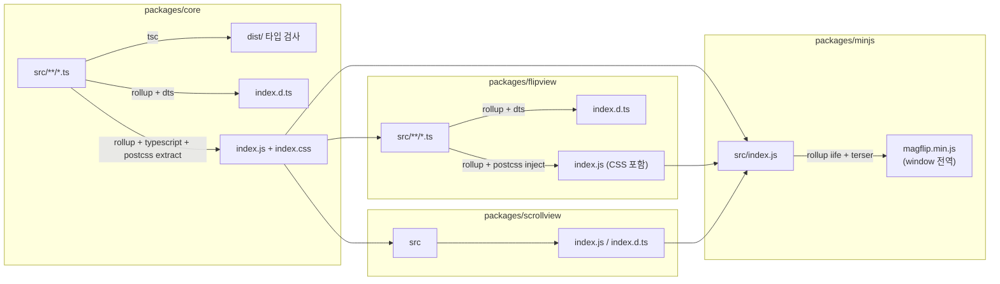
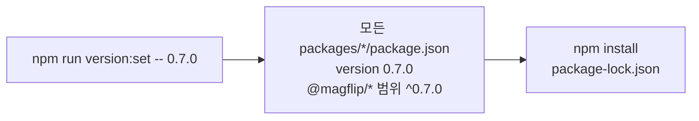
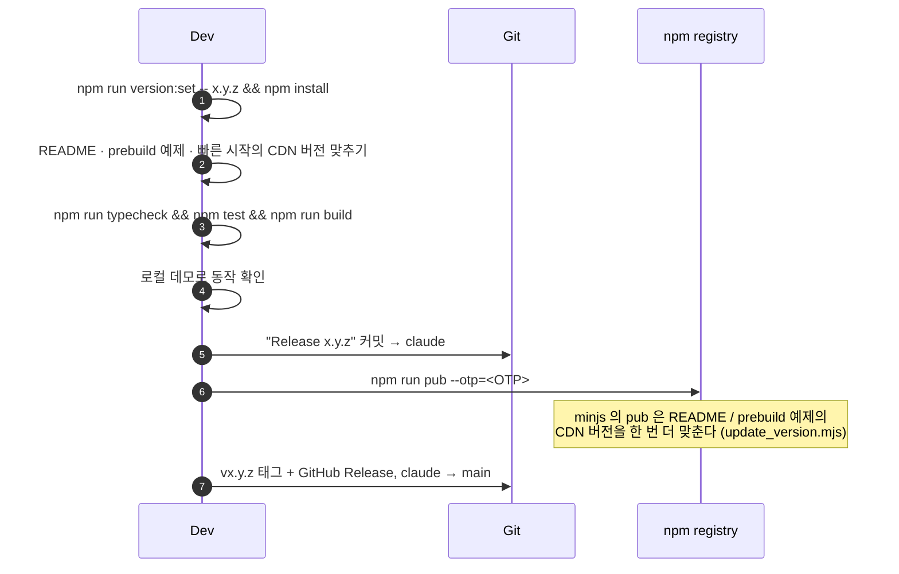

# 빌드와 배포

## 빌드 파이프라인



| 패키지 | 출력 | CSS 처리 |
| --- | --- | --- |
| core | `index.js`, `index.d.ts`, `index.css` | 별도 파일로 추출 |
| flipview | `index.js`, `index.d.ts` | JS 안에 주입 (+ core `index.css` import) |
| scrollview | `index.js`, `index.d.ts` | JS 안에 주입 |
| minjs | `magflip.min.js` (+ dev 빌드 시 `.map`) | JS 안에 주입 |

빌드 결과는 모두 `.gitignore` 대상이며, npm 배포 시 `.npmignore` 로 `src` 등이 제외됩니다.

## 버전 규칙



- **모든 `@magflip/*` 패키지가 같은 버전**을 씁니다. minjs 가 전부를 번들하고 늘 함께 배포하기 때문입니다.
- 버전은 배포할 때 `npm run version:set` 으로만 바꿉니다. 빌드는 버전을 바꾸지 않습니다.
- 0.x 에서는 기존 사용법을 깨는 변경이면 둘째 자리(0.6 → 0.7), 아니면 셋째 자리(0.6.0 → 0.6.1)를 올립니다. `^0.6.0` 은 0.6.x 만 받기 때문입니다.
- 루트 `package.json` 버전은 배포되지 않습니다. (`private: true`)

## 배포 절차



```bash
npm run version:set -- 0.7.0 && npm install
npm run build                 # 의존 순서로 전부, minjs 는 압축 빌드
npm run pub --otp=123456      # 전부 배포

# OTP 가 중간에 만료되면 남은 패키지만
npm run pub --workspace packages/shelf --otp=654321
```

:::warning 빌드 순서
flipview / scrollview / input / shelf 는 빌드된 core 를, render 는 doc 을, minjs 는 모두를 **빌드 시점에 번들**합니다.
루트 `npm run build` 는 i18n → doc → render → core → input → shelf → flipview → scrollview → minjs 순서로 빌드합니다.
:::
