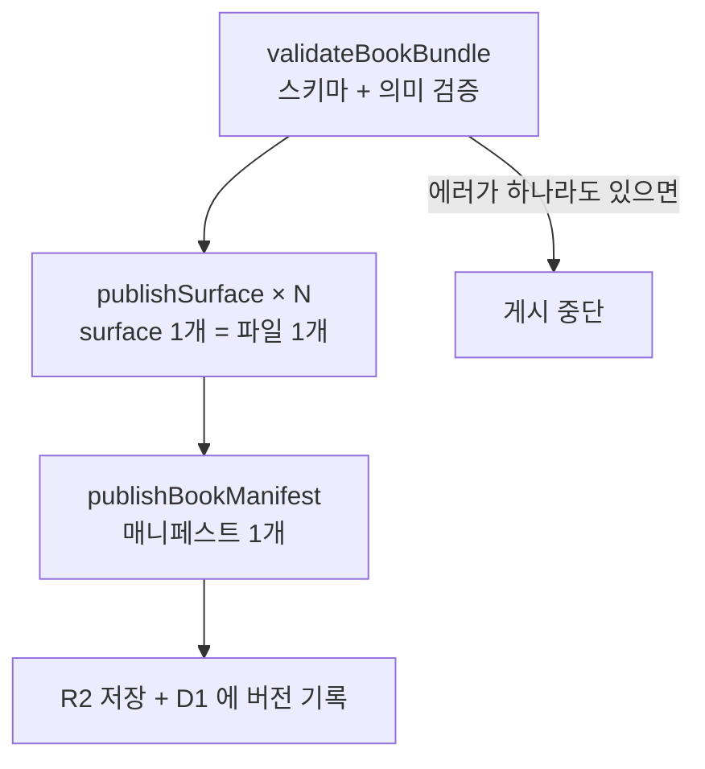
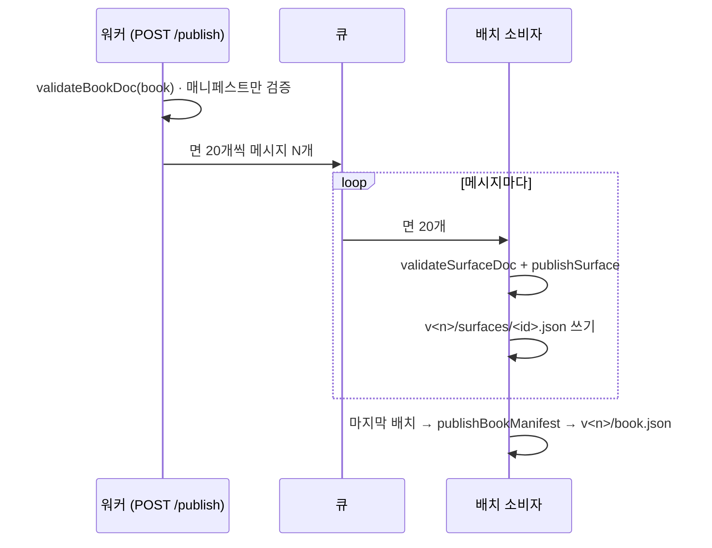

# 게시와 검증

## 파이프라인

작은 책은 `publishBookBundle(bundle, options)` 한 번으로 끝납니다. 수천 페이지 책은 한 번에 담을 수 없으므로 나눠서 게시합니다 — magBookServer 가 실제로 하는 방식입니다.

검증도 같은 크기로 나뉩니다: `validateBookDoc` 은 매니페스트만(페이지 순서·키), `validateSurfaceDoc` 은 면 하나만 봅니다. `validateBookBundle` 은 이 둘을 합친 것이라 책 전체를 메모리에 올릴 수 있을 때만 씁니다.

호출한 쪽은 결과의 `problems` 를 **반드시** `hasError()` 로 확인한 뒤 저장해야 합니다. 나눠서 게시할 때는 버전 폴더를 다 채운 뒤에야 그 버전을 독자에게 가리킵니다 — 실패해도 이전 게시본이 그대로 남는 이유입니다.

## 게시할 때 제거되는 것

`publishSurface` 는 독자가 보면 안 되는 내용을 **감추는 게 아니라 지웁니다.**

| 무엇 | 왜 |
| --- | --- |
| `isHidden: true` 요소 | 편집 중 숨긴 것 |
| pasteboard(extent 밖) 요소 | 작업용 임시 자리 |
| extent 안이지만 `isViewerVisible: false` 인 경우 trim 밖 요소 | 확장을 막은 페이지 |
| 자식이 모두 사라진 그룹 | 그릴 것이 없음 |
| 에셋이 없는 이미지·동영상·오디오 | 깨진 참조 (`MissingAsset` 에러도 함께) |
| 편집 전용 필드 (`parentId`, `order`, `name`, `isHidden`, `isLocked`) | 뷰어에 불필요 |

CSS 로 숨기기만 하면 개발자 도구로 볼 수 있으므로, "확장 페이지를 독자에게 막는다"는 요구는 이렇게 데이터 수준에서 지켜집니다. 다만 **trim 경계에 걸친 요소는 남습니다** — 잘라내면 이미지가 잘린 모습이 되기 때문이며, 렌더러가 클리핑합니다. 이미지 원본 전체를 가리고 싶다면 편집 단계에서 잘라두어야 합니다.

반대로 게시본에 채워지는 것도 있습니다.

- 마스터 요소가 합쳐집니다(맨 아래, `isFromMaster: true`).
- 텍스트 필드(쪽번호 등)가 실제 값으로 치환됩니다.
- 요소 트리가 `children` 으로 중첩된 형태가 되고, 사용된 에셋의 URL 표가 붙습니다.
- `visibleRect`, `isExpandable` 이 계산됩니다.

## 에디터도 같은 코드를 쓴다

`resolveSurfaceNodes` 는 게시와 에디터 캔버스가 함께 쓰는 함수입니다. 옵션만 다릅니다.

| | 에디터 캔버스 | 게시 |
| --- | --- | --- |
| `clipRect` | `null` (pasteboard 까지 그림) | `visibleRect` |
| `includeHidden` | `false` | `false` |
| `hasAsset` | 없음 (없는 에셋은 자리표시자) | 에셋 표 확인 |

덕분에 마스터 합성·쪽번호·트리 구성이 에디터와 뷰어에서 어긋날 수 없습니다.

## 검증

`validateBookBundle(bundle)` 이 스키마 검사(zod)와 의미 검사를 함께 수행하고 `IDocProblem[]` 를 돌려줍니다. 서버는 방 스냅샷을 저장할 때 `validateSurfaceDoc` 으로 surface 하나만 검사할 수도 있습니다.

| 코드 | 수준 | 뜻 |
| --- | --- | --- |
| `invalid-schema` | 에러 | 타입·범위·패턴 위반 (링크 스킴 포함) |
| `unsupported-schema-version` | 에러 | 이 패키지보다 새로운 버전으로 저장됨 |
| `key-id-mismatch` | 에러 | 레코드 키와 `id` 불일치 |
| `missing-surface` | 에러 | 매니페스트에 있는데 문서가 없음 |
| `orphan-surface` | 경고 | 문서는 있는데 매니페스트에 없음 |
| `spread-misaligned` | 에러 | 펼침이 왼쪽 페이지에서 시작하지 않음 |
| `missing-master` / `nested-master` | 에러 | 마스터가 없음 / 마스터가 마스터를 씀 |
| `unknown-master-override` / `invalid-master-override` | 경고 | override 대상이 없음 / 결과가 잘못되어 무시됨 |
| `extent-excludes-trim` | 경고 | 확장 영역이 페이지를 포함하지 않음 |
| `orphan-element` / `invalid-parent` / `element-cycle` / `group-too-deep` | 경고 | 트리가 자동 복구됨 |
| `missing-asset` | 에러 | 에셋 참조가 깨짐 |
| `broken-page-link` | 경고 | 링크 대상 페이지가 없음 |
| `unknown-font-family` | 경고 | 책에 없는 폰트 |
| `unknown-widget` | 경고 | 서버가 제공하지 않는 위젯 — 빈 상자로 게시됨 |
| `invalid-widget-props` | 경고 | 위젯 설정값이 그 위젯의 정의와 맞지 않음 |
| `limit-exceeded` | 에러 | `DOC_LIMITS` 초과 |

## 제한값

`DOC_LIMITS` 는 한 방이 Durable Object 에서 감당할 수 있는 크기를 지키기 위한 값입니다: surface 10,000개/책, 요소 5,000개/surface, 그룹 32단계, 텍스트 100,000자/요소, 위젯 props 64KB, 좌표 ±1,000,000px.

## 마이그레이션

저장된 JSON 은 `migrateBookBundle(json)` 을 거쳐 읽습니다.

- `book.schemaVersion` 이 현재(`SCHEMA_VERSION`)보다 **크면 거부**합니다. 옛 에디터가 모르는 필드를 조용히 버리는 사고를 막기 위해서입니다.
- 작으면 `MIGRATIONS` 에 등록된 단계를 차례로 적용한 뒤 스키마로 검증합니다.
- 호환이 깨지는 변경을 할 때는 `SCHEMA_VERSION` 을 올리고 변환 단계를 함께 추가합니다.
