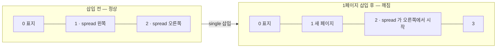
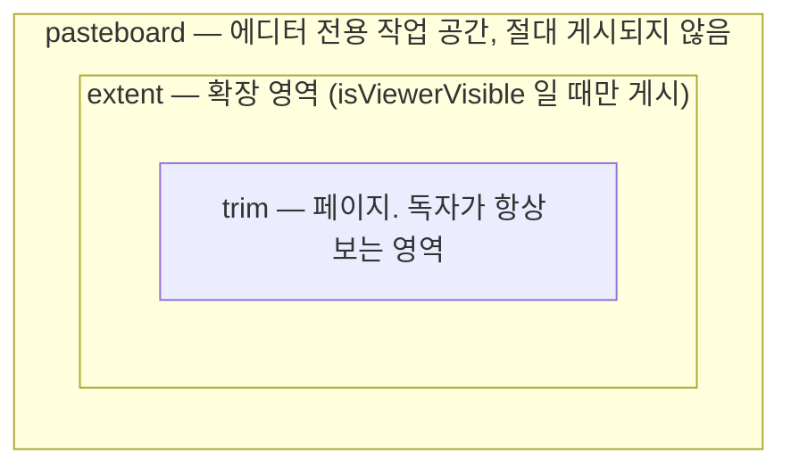

# Surface 와 페이지

## 좌표계

단위는 CSS px(줌 1 기준)이고, 원점은 surface 의 왼쪽 위입니다. x 는 오른쪽, y 는 아래가 양수입니다.

| kind | 크기 | 페이지 위치 |
| --- | --- | --- |
| `single` | `pageSize` | x = 0 |
| `spread` | `pageSize.width × 2` | 왼쪽 페이지 x = 0, 오른쪽 페이지 x = `pageSize.width` |

페이지 크기는 책 전체에서 하나입니다(`IBookDoc.pageSize`). 덕분에 페이지 index 만으로 격자 좌표가 나오고, 무한 캔버스에서 보이는 페이지를 계산하는 비용이 O(1) 이 됩니다.

**펼침 이미지**는 spread surface 위에 폭 `1200`(=600×2)짜리 이미지 요소 하나를 놓은 것입니다. 요소를 페이지별로 쪼개지 않으므로, 이미지 하나를 올리는 것과 완전히 같은 조작이 됩니다. 뷰어는 각 페이지를 그릴 때 surface 를 해당 창(window)으로 잘라서 보여줍니다.

## 페이지 index 와 좌우

`computeBookLayout(book)` 이 surface 순서를 훑어 페이지를 만듭니다.

- 표지(index 0)는 혼자 오른쪽에 섭니다. 그래서 **짝수 = 오른쪽, 홀수 = 왼쪽**이고 펼침 쌍은 (1,2), (3,4) … 입니다. (`getPageSide`, `getFacingPageIndex`)
- `readingDirection: 'rtl'` 이면 좌우가 통째로 뒤집힙니다. 쌍은 그대로이고, 먼저 읽는 페이지가 오른쪽에 옵니다.
- 쪽번호는 `pageNumbering` 이 정합니다. `firstNumberedPageIndex` 이전 페이지는 `number: null` 이라 쪽번호를 표시하지 않습니다.

## 펼침 정렬 문제

펼침은 **홀수 index 에서 시작**해야 합니다. 그런데 앞에 단일 페이지를 한 장 끼워 넣으면 뒤쪽 펼침이 한 칸씩 밀려 왼쪽/오른쪽이 뒤집힙니다.

데이터 구조만으로는 막을 수 없어서, **추가할 때 맞추고 게시할 때 검사**합니다.

- `planSurfaceInsert(book, kind, afterSurfaceId)` 가 새 면과 함께 들어가야 할 빈 페이지를 알려줍니다. 서버의 면 추가가 이 결과대로 빈 단일 페이지를 같은 변경 안에 넣습니다.
  - `blankBefore`: 펼침이 짝수 index(오른쪽)에서 시작하게 될 때. 빈 책이면 이것이 표지가 됩니다.
  - `blankAfter`: 넣는 쪽수가 홀수라 **뒤쪽 첫 펼침**이 오른쪽으로 밀릴 때. 새 면 바로 뒤에 넣으므로 그 뒤 페이지들의 좌우는 그대로입니다.
- 삭제는 맞추지 않습니다. 그래서 `computeBookLayout` 은 여전히 `SpreadMisaligned` 를 **에러**로 보고하고, 에디터는 "앞에 빈 페이지 추가" 를 제시합니다.

## 마지막 페이지

마지막 페이지는 표지 반대편(ltr 이면 왼쪽)에 혼자 서야 합니다. index 로는 **페이지 수가 짝수**라는 뜻이고, 끝이 펼침이면 자동으로 어긋납니다.

페이지를 한 장씩 넣는 동안에는 한 걸음 걸러 어긋나므로 추가할 때 맞추지 않습니다. `computeBookLayout` 이 `LastPageMisaligned` 를 **에러**로 보고해 게시만 막고, 에디터는 게시가 실패했을 때 "끝에 빈 페이지 추가" 를 보여줍니다. 페이지가 없는 책은 검사하지 않습니다.

## 펼침 합치기 · 나누기

면의 kind 는 매니페스트에만 있지만 요소 좌표가 kind 에 묶여 있어서, 바꾸려면 **방 두 개와 매니페스트**를 같이 고쳐야 합니다. 계산은 `@magflip/doc/authoring` 의 순수 함수가, 적용은 서버가 맡습니다.

| 하는 일 | 함수 | 규칙 |
| --- | --- | --- |
| 합칠 수 있는 쌍 | `findFacingSinglePair(book, layout, id)` | 둘 다 single 이고 실제로 마주보는 (홀수, 짝수) 쌍만. 합쳐도 뒤쪽 페이지 index 가 변하지 않습니다 |
| 합치기 | `planSpreadMerge` | 먼저 읽는 페이지의 면을 남깁니다. 오른쪽 페이지 요소는 `x += W`. 겹치는 id 는 새로 발급하고 자식의 `parentId` 도 따라 바꿉니다 |
| 나누기 | `planSpreadSplit` | 루트 노드(그룹은 통째로)의 bounds **중심**이 있는 페이지로 보냅니다. 요소를 자르지 않습니다 |

- **배경**: 두 페이지가 같으면 그대로, 다르면 펼침 배경은 `null` 이고 각 페이지 배경을 그 페이지의 편집 영역 크기 **잠긴 사각형**(맨 뒤 order)으로 바꿉니다. 면 배경은 면 전체에 칠해지기 때문입니다.
- **확장 영역**: 합칠 때 두 편집 영역의 합집합(한쪽이라도 `isViewerVisible` 이면 공개), 나눌 때 접힘선에서 자릅니다. 페이지 크기와 같아지면 `null`.
- **마스터 override**: 키가 페이지 모양을 따릅니다. single 마스터를 펼침에 쓰면 `id@0`/`id@1` 이므로 합칠 때 붙이고 나눌 때 뗍니다. spread 마스터는 키가 같고, 나눌 때 그 페이지 창에 들어오는 요소의 override 만 남깁니다(`resolveMasterElements` 로 판정). 다른 마스터를 따르던 페이지의 override 는 버립니다.

결과는 문서 전체가 아니라 `ISurfaceChange`(설정 · override · 지울 id · 필드 patch · 추가 요소)입니다. 남는 방에 `writeSurfaceChange` 로 **바뀐 필드만** 쓰므로, 그 면을 편집하던 사람은 연결과 텍스트 바인딩을 유지합니다. 매니페스트는 `replaceSurfaceRefs` 한 번의 변경으로 바뀝니다. 나누기는 새 방을 먼저 만든 뒤 원래 방에서 요소를 빼므로, 중간에 실패해도 요소를 잃지 않습니다.

:::caution
방을 넘나드는 변경이라 `Y.UndoManager` 로 되돌릴 수 없고, 에디터는 그 면의 실행 취소 기록을 비웁니다. 없어지는 면을 가리키던 쪽 링크(`IPageLink`)는 다른 면까지 고치지 않으므로 `BrokenPageLink` 경고가 됩니다.
:::

## trim · extent · pasteboard

한 surface 에는 세 겹의 영역이 있습니다.

- `extent: null` 이면 surface 는 페이지 크기 그대로입니다.
- `extent.rect` 는 반드시 trim 을 포함해야 합니다(어기면 `ExtentExcludesTrim` 경고, 게시 시 자동으로 합집합 처리).
- **`isViewerVisible: false`** 면 독자는 확장할 수 없고, 게시할 때 trim 밖 요소가 **파일에서 제거**됩니다. CSS 로 숨기는 것이 아니므로 개발자 도구로도 볼 수 없습니다.
- `isViewerVisible: true` 면 게시본에 `isExpandable: true` 와 `visibleRect` 가 담기고, 뷰어는 확장 버튼을 띄울 수 있습니다.

독자에게 막아도 **작가는 계속 그 영역에서 편집합니다**. 그래서 영역을 묻는 함수가 둘입니다.

| 묻는 것 | 함수 | `isViewerVisible: false` 일 때 |
| --- | --- | --- |
| 독자가 보는 영역 | `getVisibleRect` | trim |
| 작가가 그리는 영역 | `getEditRect` | extent 그대로 |

에디터 캔버스는 `getEditRect` 를, 게시는 `publishSurface` 안의 규칙(= `getVisibleRect` 와 같은 판단)을 씁니다.

extent 를 명시적인 사각형으로 둔 이유는, 요소 위치에서 자동 계산하면 "잠깐 옆에 빼둔 이미지" 때문에 확장 영역이 멋대로 커지기 때문입니다. 그런 임시 요소를 두는 자리가 pasteboard 입니다.

## 관련 코드

| 하는 일 | 함수 |
| --- | --- |
| 순서 → 페이지 | `computeBookLayout(book)` |
| 페이지의 좌우 | `getPageSide(index, direction)` |
| 마주보는 페이지 | `getFacingPageIndex(index, pageCount)` |
| surface·페이지 사각형 | `getSurfaceTrimRect`, `getPageTrimRect`, `getVisibleRect`, `getEditRect` |
| 펼침 시작 가능 여부 | `canSpreadStartAt(index)` |
| 면 추가 때 필요한 빈 페이지 | `planSurfaceInsert(book, kind, afterSurfaceId)` |
| 펼침 합치기 · 나누기 | `findFacingSinglePair`, `planSpreadMerge`, `planSpreadSplit`, `writeSurfaceChange` |
