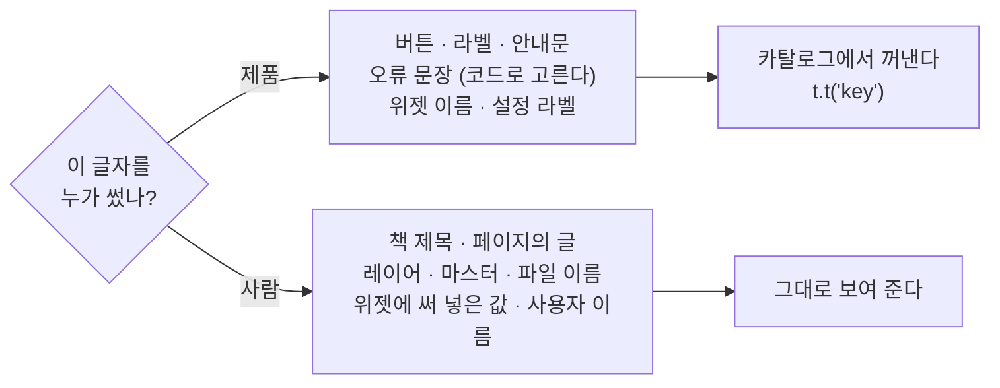

# 다국어

화면에 나오는 말의 언어를 다루는 공용 코드입니다(`magBookFlip/packages/i18n`). 에디터·서버·TV 앱이 같은 형식을 씁니다. 뷰어와 렌더러는 쓰지 않습니다 — 거기서 그리는 글자는 전부 책의 내용이기 때문입니다.

지금 있는 언어는 **영어(`en`)와 한국어(`ko`)** 두 개이고, 영어가 원본입니다.

## 가장 중요한 한 줄

> **화면의 말은 번역하고, 책과 DB 에서 온 값은 번역하지 않는다.**



경계에 있는 것이 하나 있습니다. **편집기·서버가 책에 써 넣는 이름**(새 마스터의 이름, 제목 없는 새 책, 펼침을 합칠 때 남는 '배경' 사각형, 위젯의 기본값)은 *쓰는 순간* 그 사람의 언어로 한 번 정해지고, 그 뒤로는 저자가 직접 친 글과 똑같이 취급합니다. 나중에 다른 언어로 열어도 바뀌지 않습니다 — 책의 내용이기 때문입니다.

## 조각

| 이름 | 하는 일 |
| --- | --- |
| `Locale` | `'en' \| 'ko'`. 언어를 나르는 모든 것이 이 타입을 쓴다(`string` 금지) |
| `resolveLocale({ chosen, system })` | 고른 언어 → 기기 언어 → 영어 순으로 하나를 고른다 |
| `matchLocale('ko-KR')` | 지역은 무시하고 언어만 본다 → `'ko'` |
| `parseAcceptLanguage(header)` | `Accept-Language` 를 품질 순 목록으로 |
| `MessageCatalog` / `MessageTranslations` | 원본(영어) 카탈로그와 다른 언어의 번역(`Partial`) |
| `createTranslator(locale, 카탈로그, 번역)` | `t` · `has` · `formatNumber` · `formatDateTime` · `formatList` · `formatBytes` |
| `ILocalizedText` / `pickText` | 데이터로 오가는 `{ en, ko }` 문자열 (서버 위젯 등록부) |
| `readStoredLocale` / `storeLocale` | 브라우저가 기억하는 언어 (`magflip.locale`) |

**말 자체는 이 패키지에 없습니다.** 각 앱이 자기 카탈로그를 가집니다 — 에디터의 문구를 서버가 알 필요가 없기 때문입니다.

## 카탈로그 규칙

```ts
// en.ts — 키의 주인. 여기 없는 키는 타입 오류다.
export const EN = {
  'pages.page': 'Page {number}',
  'publish.done': { one: 'Published {count} page.', other: 'Published {count} pages.' },
} as const;

// ko.ts — Partial. 빠진 키는 영어로 나온다.
export const KO: MessageTranslations<Key> = {
  'pages.page': '{number}쪽',
  'publish.done': { other: '{count}쪽을 게시했습니다.' },  // 한국어는 수를 세지 않는다
};
```

- **문장 단위로 키를 만든다.** 문자열을 코드에서 이어 붙이면 어순이 다른 언어에서 무너진다. 조건이 있으면 키 두 개로 나눈다.
- 값이 없는 `{name}` 은 지우지 않고 그대로 남긴다 — 조용히 지우면 말이 되는 *다른* 문장이 된다.
- 복수형 이름(`one`·`other`·`few`…)은 `Intl.PluralRules` 가 돌려주는 그대로다.
- 숫자·날짜·목록·파일 크기는 `t.formatNumber` 같은 `Intl` 래퍼로. `t` 에 넘긴 숫자도 자동으로 그 언어의 표기를 따른다.

## 언어는 값이지 전역이 아니다

서버는 요청 두 개를 서로 다른 언어로 동시에 답합니다. 그래서 "현재 언어" 같은 전역이 없고, 번역기를 만들어 넘깁니다. 브라우저 앱은 탭 하나에 화면 언어가 하나뿐이라 store 의 `locale` 을 보는 훅(`useT`)을 쓰고, React 밖(ProseMirror 스키마 등)에서만 현재 번역기를 꺼내 씁니다.

## 언어를 하나 더 넣을 때

1. `packages/i18n/src/locale.ts` 의 `LOCALES` 와 `LOCALE_NAMES` 에 추가(이름은 그 언어로 쓴 제 이름).
2. 앱마다 `i18n/messages/<코드>.ts` 를 만들고 등록한다. 다 채우지 않아도 된다 — 빠진 것은 영어로 나온다.
3. 서버 `src/widgets/registry.ts` 의 `{ en, ko }` 에 그 언어 칸을 채운다.
4. 에디터의 `__tests__/messages.test.ts` 에서 "완성된 언어" 목록에 넣을지 정한다(넣으면 누락이 테스트로 잡힌다).

## UX/UI 를 바꿀 때 확인할 것

새 화면·새 버튼을 만들 때마다 다음을 함께 합니다.

| 확인 | 왜 |
| --- | --- |
| 새 문자열을 `en` + `ko` 두 곳에 넣었는가 | 하나만 넣으면 조용히 영어가 섞인다 |
| 리터럴이 JSX·`label`·`title`·`placeholder` 에 남아 있지 않은가 | 하나라도 남으면 그 자리만 안 바뀐다 |
| 문장을 코드로 이어 붙이지 않았는가 | 어순이 다른 언어에서 깨진다 |
| **영어가 한국어보다 30% 쯤 길다** — 버튼·패널이 잘리지 않는가 | 폭을 지금 글자에 맞춰 고정하지 말 것 |
| 숫자·날짜·크기를 `Intl` 로 썼는가 | 천 단위 기호·날짜 순서가 언어마다 다르다 |
| 책·DB 에서 온 값을 번역하지 않았는가 | 저자의 글은 저자의 것이다 |
| 두 언어로 한 번씩 보았는가 (에디터: 설정 → 언어) | 길이·줄바꿈 문제는 눈으로만 보인다 |

제품별 적용은 [에디터의 설정](/editor/user/settings), [에디터 내부 규칙](/editor/dev/rules), [서버 API](/server/user/api) 를 보세요.
