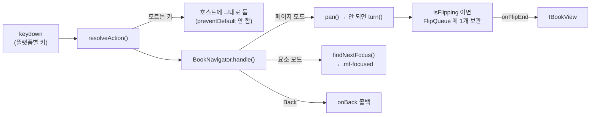

# `@magflip/input` 내부

키 입력을 책 조작으로 바꾸는 패키지입니다(`packages/input`). 사용법은 [리모컨·키보드로 읽기](../user/guides/remote-control.md).

의존은 **`@magflip/core` 하나**뿐이고, 뷰에는 `IBookView` 규약으로만 접근합니다. 그래서 FlipView 가 아닌 다른 뷰에도 그대로 붙습니다.

## 파일

| 파일 | 책임 | DOM |
| --- | --- | --- |
| `actions.ts` | `InputAction` — 키가 아니라 "뜻" | 없음 |
| `keyMap.ts` | 키 이름·키 번호 → 동작. **플랫폼 차이는 여기에만** | 없음 |
| `flipQueue.ts` | 넘기는 중에 들어온 요청 보관 | 없음 |
| `spatialFocus.ts` | 사각형 목록 + 방향 → 다음 대상 | 없음 |
| `focusTargets.ts` | 펼친 페이지 DOM → 고를 수 있는 요소와 좌표 | 읽기 |
| `bookNavigator.ts` | 동작 → `IBookView` 호출, 모드, 포커스 표시 | 읽기·쓰기 |
| `remoteController.ts` | `keydown` 연결, `dispatch`, `destroy` | 이벤트 |
| `input.css` | `.mf-focused` | – |

계산은 DOM 없는 파일에 모아 두어 `__tests__` 에서 그대로 검증합니다.

## 흐름



## 규칙

- **진짜 `focus()` 를 부르지 않는다.** 위젯은 다른 출처 iframe 이라, 포커스가 안으로 들어가면 키 이벤트가 페이지로 오지 않아 되돌아올 방법이 없습니다. `.mf-focused` 클래스로만 표시합니다.
- **링크는 `element.click()`** 으로 실행합니다. 링크의 뜻(`onPageLink` / `onUrlLink`)은 `@magflip/render` 가 정하므로([렌더링](./doc-model/rendering.md)) 같은 규칙을 두 번 구현하지 않습니다.
- **고를 수 있는 요소와 좌표는 쓸 때마다 다시 잽니다.** 페이지는 처음 보일 때 만들어지고, 넘기는 동안 움직입니다.
- **넘김이 끝나면 표시를 지우고 페이지 모드로 돌아갑니다.** 페이지 링크로 이동한 뒤에도 마찬가지입니다 — 새 펼침에서는 좌우가 다시 넘김이어야 합니다.
- **대기열은 오래된 요청을 버립니다.** 전부 쌓으면 손을 뗀 뒤에도 책이 계속 넘어갑니다. 키를 누르고 있을 때(`event.repeat`)는 대기열이 비었을 때만 받습니다.
- **쓰지 않은 키는 `preventDefault` 하지 않습니다.** `handle()` 이 사용 여부를 반환하고 `RemoteController` 가 그때만 이벤트를 가져갑니다.

## 방향 포커스 계산

`findNextFocus(from, candidates, direction)` 는 진행 방향 뒤에 있는 것을 버리고, 남은 것에 점수를 매겨 가장 작은 것을 고릅니다.

```
점수 = 진행 방향 거리 + 옆으로 벗어난 거리 × 3
```

옆으로 벗어난 거리는 두 사각형이 그 축에서 겹치면 0 입니다. 그래서 **대각선으로 더 가까운 것보다 정면에 있는 것**을 고릅니다. 가장자리에서는 `undefined` 를 돌려주고, 좌우라면 호출한 쪽이 페이지를 넘깁니다.

## 이동과 넘김의 갈림

| 키 | 배율 1 | 확대 상태 |
| --- | --- | --- |
| ↑ ↓ | 책이 화면보다 높으면 이동 | 이동 |
| ← → | 바로 넘김 | 이동, 그 방향 끝에 닿으면 넘김 |

좌우를 확대했을 때만 이동으로 쓰는 이유는, 창보다 조금 넓은 책에서 좌우 키가 몇십 px 씩 미끄러지기만 하고 넘어가지 않기 때문입니다. 이동 자체는 [`FlipView.pan()`](./flipview/flip-geometry.md#화면-이동pan-처리) 이 하고, 더 갈 곳이 없으면 `false` 를 돌려줍니다.

## 확인

```bash
npm test -w packages/input     # vitest + happy-dom
npm run build:local && npm run serve
```

로컬 예제(`docs/examples/local`)가 `RemoteController` 를 연결해 두었습니다. `?tv=1` 이면 마우스 툴바 없이 열립니다.

:::note
앱 브라우저 창에서는 rAF 가 약 2fps 로 느려 500ms 이하 애니메이션 시간을 잴 수 없습니다. 넘김 시간을 확인할 때는 `autoFlip.duration` 을 길게(5000) 두세요.
:::
