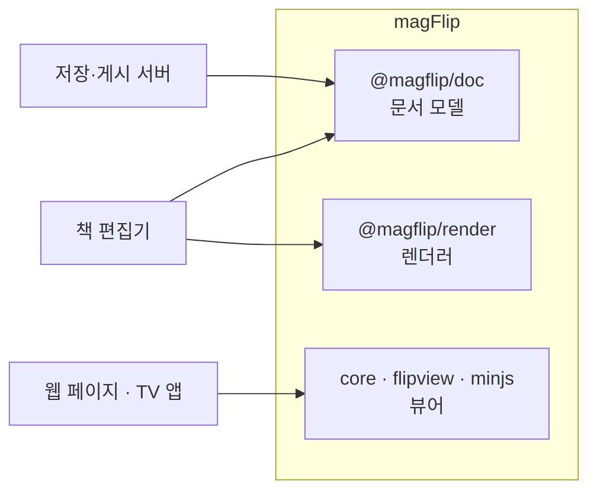

# 개발자 가이드

MagFlip **자체를 개발·유지보수**하는 사람을 위한 문서입니다.
라이브러리를 _사용_하는 방법은 [사용자 가이드](../user/intro.md)를 참고하세요.

## 패키지를 쓰는 쪽

MagFlip 은 한 저장소(npm workspaces)에 든 여러 패키지입니다. 앱은 필요한 패키지만 npm 으로 설치하고, 이 저장소와 함께 개발할 때는 `file:` 링크로 `packages/*` 를 가리킵니다.

| 쓰는 쪽 | 패키지 |
| --- | --- |
| 웹 페이지에 뷰어를 넣을 때 | `core` + `flipview` (또는 CDN 번들 `minjs`) |
| 책 편집기 | `doc` + `render` (+ `i18n`) |
| 저장·게시 서버 | `doc` (+ `i18n`) |
| 리모컨으로 읽는 TV 앱 | `core` + `flipview` + `input` |

## 이 문서를 읽는 순서

| 알고 싶은 것 | 문서 |
| --- | --- |
| 처음 clone 후 무엇을 실행하나? | [로컬 개발 환경](./development/local-setup.md) |
| 패키지들이 어떻게 연결되나? | [시스템 구조](./architecture/overview.md) |
| 어떤 파일을 고쳐야 하나? | [폴더 구조](./architecture/folder-structure.mdx) |
| 클래스 관계는? | [클래스 모델](./architecture/class-model.md) |
| 책장·격자와 책이 날아가는 건 어디서? | [책 객체와 @magflip/shelf](./book-object.md) |
| 페이지가 어떻게 교체되나? | [Page Window](./flipview/page-window.md) |
| 마우스 이벤트 → 애니메이션 흐름은? | [이벤트 흐름](./flipview/event-flow.md) |
| 접힘 모양/그림자 계산은? | [Flip 기하 계산](./flipview/flip-geometry.md) |
| 코드 스타일 규칙은? | [코딩 컨벤션](./development/coding-conventions.md) |
| 에디터가 만드는 책 데이터 형식은? | [문서 모델 개요](./doc-model/overview.md) |
| 펼침 2페이지·확장 페이지는 어떻게 표현하나? | [Surface 와 페이지](./doc-model/surface-and-pages.md) |
| 동시 편집은 어떻게 합쳐지나? | [동시 편집](./doc-model/collaboration.md) |
| 게시된 책을 무엇이 그리나? | [렌더러](./doc-model/rendering.md) |
| 화면의 말은 어느 언어로 나오나? | [다국어](./i18n.md) |
| npm 배포는? | [빌드와 배포](./development/build-and-release.md) |
| 알려진 문제는? | [알려진 이슈](./known-issues.md) |

## 30초 요약

- **npm workspaces 모노레포**: `packages/i18n`, `doc`, `render`, `core`, `input`, `shelf`, `flipview`, `scrollview`, `minjs`
- **TypeScript + Rollup** 으로 각 패키지를 ESM(`index.js`) + 타입(`index.d.ts`)으로 빌드
- `minjs` 는 모든 패키지를 IIFE 번들(`magflip.min.js`)로 묶어 전역에 노출
- UI 프레임워크 없이 **DOM을 직접 생성**하고, Flip 효과는 **SVG mask + CSS 변수 + transform** 으로 구현
