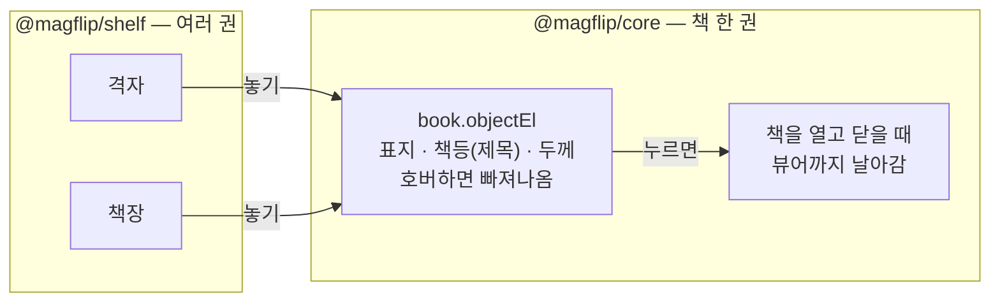

import DemoFrame from '@site/src/components/DemoFrame';

# 책 고르기 (격자·책장)

독자가 읽을 책을 고르는 화면입니다. 여러 권을 **격자**(표지)로 늘어놓거나, **책장**에 책등이 보이게 꽂아 둘 수 있습니다.

<DemoFrame />

| 동작 | 격자 | 책장 |
| --- | --- | --- |
| 보이는 면 | 앞표지, 아래에 제목 | 책등. 제목이 세로로 적혀 있습니다 |
| 마우스를 올리면 | 표지가 들리며 살짝 돌아 책등이 보입니다 | 책이 앞으로 빠져나오며 옆으로 앞표지가 보입니다 |
| 누르면 | 책이 뷰어로 날아와 **닫힌 앞표지**가 됩니다 | 책이 빠져나와 돌면서 날아와 **닫힌 앞표지**가 됩니다 |
| 뷰어를 닫으면 | 책이 제자리로 돌아갑니다 | 책이 돌면서 제자리에 다시 꽂힙니다 |
| 책이 많으면 | 칸이 차면 다음 줄로 | 선반이 적어도 세 칸 있고, 한 칸이 차면 다음 책은 아래 칸에 섭니다. 화면이 좁아지면 넘치는 책부터 아래로 내려갑니다 |

표지가 뷰어에 놓이면 그다음은 평소와 같습니다. 표지를 넘기면 읽기 시작합니다.

책장에서 빠져나온 책은 앞표지를 오른쪽으로 펼쳐 옆 책 몇 권을 덮습니다. 그래도 마우스를 오른쪽으로 옮기면 덮인 책이 한 권씩 차례로 빠져나옵니다. 책이 마우스를 받는 곳은 움직이는 책이 아니라 **책이 꽂힌 자리**이기 때문입니다.

책장은 나무로 짠 모양입니다. 선반과 윗판은 결이 가로로, 옆판은 세로로 나 있습니다.

## 무엇이 어디에 있나요?

한 권의 모습과 움직임은 `@magflip/core` 에 있고, 여러 권을 늘어놓는 일은 `@magflip/shelf` 가 합니다.



## 쓰기

```js
const shelfManager = new BookShelfManager();
const bookViewer = shelfManager.getBookViewer();
const flipView = new FlipView();
bookViewer.registerView(flipView);
bookViewer.setCurView(flipView.id);

const shelf = new BookShelf({ manager: shelfManager, layout: ShelfLayout.Shelf });
shelf.addBook(book);   // book 은 importPages 까지 마친 Book
```

`shelf.addBook(book)` 이 책을 매니저에도 넣습니다. 책을 누르면 매니저가 `pickupAndView(book)` 로 엽니다.

npm 으로 쓸 때는 패키지와 CSS 를 따로 가져옵니다(번들 `magflip.min.js` 에는 이미 들어 있습니다).

```bash
npm install @magflip/shelf
```

```ts
import { BookShelf, ShelfLayout } from '@magflip/shelf';
import '@magflip/shelf/index.css';
```

:::info 배포 버전
책장이 core 에서 `@magflip/shelf` 로 옮겨졌습니다. CDN 의 `@magflip/minjs@0.5.48` 에는 아직 `BookShelf` 가 없고, 예전처럼 core 가 책장을 그립니다.
:::

## 격자와 책장 바꾸기

```js
shelf.setLayout(ShelfLayout.Grid);   // 표지 격자
shelf.setLayout(ShelfLayout.Shelf);  // 책등이 보이는 책장
```

바꾸면 책마다 제자리에서 돌아 새 면을 보여 줍니다. **전환 버튼은 라이브러리가 그리지 않습니다.** 앱의 화면에 맞는 말과 모양으로 직접 만드세요. 로컬 예제는 `Grid` / `Shelf` 버튼 두 개를 둡니다.

## 책의 모습

| 무엇 | 어디서 오나 |
| --- | --- |
| 앞표지 · 뒤표지 | `thumbnails.cover.front` / `thumbnails.cover.back` |
| 책등 | `thumbnails.spine` 위에 어둡게 덮고 `title` 을 세로로 씁니다. 표지를 넣으면 표지의 왼쪽 가장자리가 보입니다 |
| 두께 | 쪽수(`lastPageIndex + 1`). 얇은 잡지도 제목이 읽히도록 최소 두께가 있고, 너무 두꺼워지지 않게 최대 두께가 있습니다 |
| 높이 | 판형(`importPages` 에 준 페이지 크기). 책장에서는 **가장 큰 책**을 기준으로 줄어들어 실제 책장처럼 들쭉날쭉합니다 |
| 그림이 없을 때 | 제목으로 정해지는 색에 제목을 씁니다 |

책등의 제목은 한글이면 글자가 서고, 영문이면 옆으로 눕습니다(실제 책등처럼 위에서 아래로 읽습니다). 제목이 길면 `…` 로 줄입니다.

:::note 화면의 말
제목·표지는 책의 내용이라 번역하지 않습니다. 책장 자체에는 글자가 없습니다. 전환 버튼처럼 앱이 넣는 말은 앱이 [다국어 규칙](../../dev/i18n.md)을 따라 정합니다.
:::

## 키보드

책마다 `Tab` 으로 갈 수 있습니다. 고른 책은 마우스를 올린 것처럼 빠져나오고, `Enter` 나 `Space` 로 엽니다. 뷰어를 닫으면 방금 읽은 책에 다시 서 있습니다.

## 날아가는 애니메이션 끄기

```js
new BookShelfManager({ animateBook: false });
```

운영체제에서 **동작 줄이기**를 켠 독자에게는 이 설정과 상관없이 날아가지 않고 바로 열립니다.

## 크기와 색 바꾸기

CSS 변수로 바꿉니다. `#bookShelf` 나 그 바깥 요소에 적으세요.

| 변수 | 기본값 | 뜻 |
| --- | --- | --- |
| `--mf-grid-column-width` | `150px` | 격자 한 칸의 최소 너비 |
| `--mf-grid-cover-height` | `210px` | 격자에서 표지의 최대 높이 |
| `--mf-shelf-book-height` | `200px` | 책장에서 가장 큰 책의 높이 |
| `--mf-shelf-shortest` | `.62` | 책장에서 가장 작은 책이 가장 큰 책의 몇 배까지 작아지나 |
| `--mf-shelf-headroom` | `30px` | 책 위로 남는 공간 |
| `--mf-shelf-board` | `16px` | 선반 두께 |
| `--mf-shelf-frame` | `16px` | 책장 옆판·윗판 두께 |
| `--mf-shelf-min-rows` | `3` | 책이 적어도 선반을 몇 칸 그리나(비어 있어도 그립니다) |
| `--mf-shelf-back` / `--mf-shelf-wood` | 밝은 벽 / 나무색 | 선반 뒤 벽, 나무(선반·옆판·윗판) 색. 나무 결은 이 색 위에 겹쳐 그려지므로 색을 바꿔도 결은 남습니다 |
| `--mf-book-focus-color` | `#4da3ff` | 키보드로 고른 책의 테두리 |

```css
#bookShelf {
  --mf-shelf-book-height: 260px;
  --mf-shelf-min-rows: 2;
  --mf-shelf-wood: #6b4a2f;   /* 어두운 호두나무 */
  --mf-shelf-back: #2b2320;
}
```

## 직접 늘어놓기

`@magflip/shelf` 를 쓰지 않고 앱이 직접 배치해도 됩니다. 책의 `objectEl` 을 원하는 곳에 넣고, 책을 매니저에 넣기만 하면 누르는 대로 열립니다.

```js
shelfManager.importBookToShelf(book);
book.setObjectFace(BookFace.Spine);          // 책등이 보이게
book.objectEl.style.setProperty('--mf-book-height', '180px');
myListEl.appendChild(book.objectEl);
```

책을 넣는 요소에는 `isolation: isolate` 를 주세요. 빠져나온 책은 옆 책 위로 올라오도록 `z-index` 를 받는데, 이것이 책장을 덮고 열리는 뷰어보다 위로 올라오지 않게 합니다(`@magflip/shelf` 는 스스로 그렇게 합니다).

```css
#myList { isolation: isolate; }
```

`objectEl` 은 처음 요구할 때 만들어집니다. 화면에 놓지 않은 책(예: 자기 책장을 그리는 TV 앱)은 표지 그림을 불러오지 않고, 날아가지도 않고 바로 열립니다.
