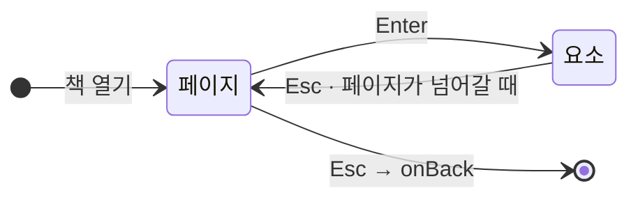

# 리모컨·키보드로 읽기

`@magflip/input` 은 키 입력을 책 조작으로 바꿉니다. TV 앱을 위해 만들었지만 웹에서도 그대로 쓸 수 있습니다. 마우스가 없어도 책을 넘기고, 페이지 안의 링크와 동영상을 쓸 수 있습니다.

```bash
npm install --save-dev @magflip/input
```

번들(`magflip.min.js`)에는 이미 들어 있습니다.

## 붙이기

책을 **연 뒤에** 연결하세요. 페이지 요소는 책이 열릴 때 만들어집니다.

```js
let controller;

const shelfManager = new BookShelfManager({
  onViewerOpen: (book) => {
    controller = new RemoteController({
      view: flipView,
      // 페이지는 처음 보일 때 만들어지므로, 이미 만들어진 것만 돌려줍니다.
      getPageContentEl: (index) => {
        const page = book.getPage(index);
        return page && page.hasElements ? page.contentEl : undefined;
      },
      onBack: () => bookViewer.closeViewer(),
    });
  },
  onViewerClose: () => {
    controller?.destroy();   // 닫은 책의 키를 계속 받지 않도록
    controller = undefined;
  },
});
```

## 기본 키

| 키 | 페이지를 볼 때 | 요소를 고를 때 |
| --- | --- | --- |
| ← → | 이전 / 다음 펼침 | 왼쪽 / 오른쪽 요소. 끝에서 한 번 더 누르면 페이지를 넘깁니다 |
| ↑ ↓ | 책이 화면보다 크면 위아래로 이동 | 위 / 아래 요소 |
| `Enter` | 요소 고르기 시작 | 링크 열기, 동영상 재생·정지 |
| `Esc`, `Backspace` | `onBack` 호출 | 페이지 보기로 돌아가기 |
| `PageUp` `PageDown`, 채널 키 | 이전 / 다음 펼침 | 이전 / 다음 펼침 |



고른 요소에는 `mf-focused` 클래스가 붙습니다. 색과 굵기는 CSS 변수로 바꾸세요.

```css
:root {
  --mf-focus-color: #ffd400;
  --mf-focus-width: 6px;
  --mf-focus-offset: 4px;
}
```

:::note
고른 요소에 실제 `focus()` 를 주지는 않습니다. 위젯은 다른 출처의 iframe 이라, 포커스가 그 안으로 들어가면 리모컨 키가 페이지로 돌아오지 않습니다.
:::

## TV 리모컨

삼성 Tizen(`10009`)과 LG webOS(`461`)의 뒤로가기처럼 이름 없이 번호로만 오는 키도 기본으로 처리합니다.

Android TV 의 뒤로가기는 **웹 페이지가 아니라 앱으로** 갑니다. 앱에서 직접 넘기세요.

```js
controller.dispatch(InputAction.Back);
```

## 키 바꾸기

```js
new RemoteController({
  view: flipView,
  getPageContentEl,
  keyMap: { ' ': InputAction.PageNext, '+': InputAction.ZoomIn },
  keyCodeMap: { 427: InputAction.PagePrev },
  panStep: 200,        // ↑↓←→ 로 한 번에 움직이는 거리(px), 기본 120
});
```

이름을 지정하지 않은 키는 기본값 그대로 동작합니다. 우리가 모르는 키는 건드리지 않으므로, 호스트의 단축키는 그대로 살아 있습니다.

## 확대와 함께 쓰기

`ZoomIn` / `ZoomOut` 동작은 배율을 바꾸고, 방향키가 [화면 이동](./viewer-control.md#줌과-화면-이동)을 합니다. 기본 키는 없으므로 직접 지정하거나 `dispatch` 로 부르세요.

```js
controller.dispatch(InputAction.ZoomIn);
```

## 직접 다루기

`controller.navigator` 로 지금 상태를 읽고 조작할 수 있습니다.

| 멤버 | 설명 |
| --- | --- |
| `mode` | `'page'` 또는 `'element'` |
| `focusedElement` | 지금 고른 요소 |
| `enterElementMode()` / `leaveElementMode()` | 모드 바꾸기 |
| `handle(action)` | 동작 실행. 사용했으면 `true` |

`RemoteController` 의 `onModeChange` 로 모드가 바뀔 때 화면에 안내를 띄울 수 있습니다.

## 직접 해 보기

로컬 예제([`docs/examples/local`](/magflip/user/demo))에 연결되어 있습니다. `?tv=1` 을 붙이면 마우스 툴바 없이 TV 처럼 볼 수 있습니다.
