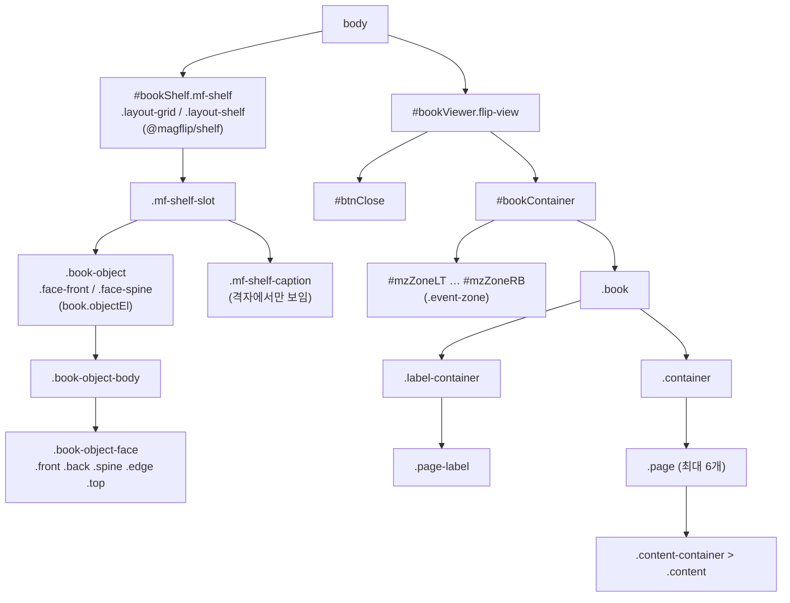

# 스타일 커스터마이징

## MagFlip이 만드는 DOM



`#bookViewer` 가 문서에 없으면 `body` 끝에 자동으로 생성됩니다. `#bookShelf` 는 `@magflip/shelf` 의 `BookShelf` 가 같은 방식으로 만듭니다(다른 요소를 `element` 로 넘길 수도 있습니다).
원하는 위치에 두고 싶다면 미리 빈 요소를 만들어 두세요.

## 자주 쓰는 커스터마이징

```css
/* 책 크기 — 책장에서 가장 큰 책의 높이, 격자 한 칸의 너비 */
#bookShelf {
  --mf-shelf-book-height: 240px;
  --mf-grid-column-width: 180px;
}

/* 뷰어 배경 */
#bookViewer.flip-view {
  background: #1f1f1f;
}

/* 닫기 버튼 */
#bookViewer #btnClose {
  background-color: #c2410c;
}
```

책장·격자의 변수 전체는 [책 고르기](./bookshelf.mdx#크기와-색-바꾸기)에 있습니다.

## 책 객체 (`.book-object`)

책 한 권의 모습은 CSS 변수로 크기가 정해지는 3D 상자입니다. 높이만 정하면 너비는 판형, 두께는 쪽수에서 나옵니다.

| 변수 | 누가 정하나 | 의미 |
| --- | --- | --- |
| `--mf-book-height` | 책을 놓는 쪽(`BookShelf`, 앱) | 그려지는 높이. 기본 `240px` |
| `--mf-book-aspect` | 책 | 표지의 너비 ÷ 높이 |
| `--mf-book-spine` | 책 | 두께 ÷ 높이 (쪽수에 따라 커짐) |
| `--mf-book-trim-height` | 책 | 디자인한 높이(단위 없음). 책장이 책끼리 키를 비교할 때 씁니다 |
| `--mf-book-color` | 책 | 그림이 없을 때의 색 |
| `--mf-book-focus-color` | 앱 | 키보드로 고른 책의 테두리 색 |

| 클래스 (`.book-object`) | 의미 |
| --- | --- |
| `face-front` / `face-spine` / `face-back` | 보이는 면 (`book.setObjectFace`) |
| `is-raised` | 마우스를 올리거나 `Tab` 으로 고른 것처럼 앞으로 빠져나온 모습. 리모컨 포커스처럼 실제 포커스가 없는 곳에서 붙이세요 |
| `is-picked-up` | 뷰어에 가 있어 자리가 비어 있음 |
| `is-flying` | 날아가는 복사본 (`body` 에 붙었다가 내려앉으면 사라짐) |

| 클래스 (`#bookViewer`) | 의미 |
| --- | --- |
| `book-arriving` | 책이 날아오는 중. 진짜 책은 복사본이 내려앉을 때까지 숨어 있습니다 |
| `is-closing` | 닫혀서 흐려지는 중 |

## 상태 클래스

| 클래스 (`#bookContainer`) | 의미 |
| --- | --- |
| `ready-to-open front` | 앞표지만 보이는 닫힌 상태 |
| `ready-to-open end` | 뒤표지만 보이는 닫힌 상태 |
| `left-page-flipping` / `right-page-flipping` | 왼쪽/오른쪽 페이지가 넘어가는 중 |

:::warning
MagFlip CSS에는 `img { width: 100%; height: 100%; }` 전역 규칙이 포함되어 있습니다.
페이지의 다른 이미지에 영향을 줄 수 있으니 필요하면 해당 영역에서 덮어쓰세요.
:::
