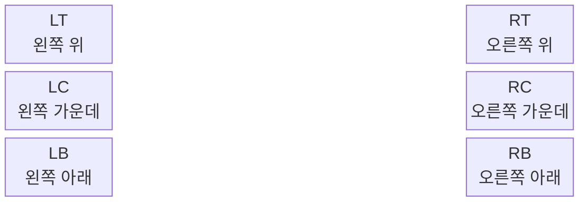
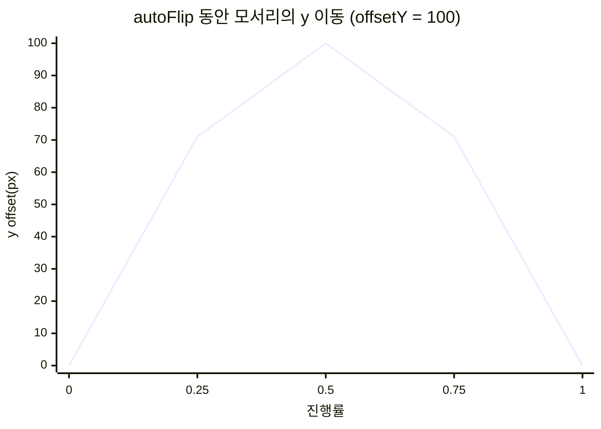

# 뷰어 제어

## 마우스로 넘기기

Flip 뷰는 책 위에 보이지 않는 **6개의 이벤트 영역(Zone)** 을 둡니다.



| 동작 | 결과 |
| --- | --- |
| Zone에 마우스 올리기 | 페이지 모서리가 마우스를 따라 살짝 들립니다. |
| Zone에서 마우스 벗어나기 | 모서리가 원래 위치로 돌아갑니다. |
| Zone에서 누른 채 드래그 | 페이지를 잡고 넘깁니다. |
| 마우스 놓기 | 반대편에 더 가까우면 넘어가고, 아니면 제자리로 돌아갑니다. |
| Zone 클릭 (누른 자리에서 그대로 놓기) | 들린 모서리에서부터 페이지가 끝까지 넘어갑니다. |

오른쪽 Zone은 **다음 페이지**, 왼쪽 Zone은 **이전 페이지** 방향입니다.

[하드커버](./book-and-pages.md#하드커버) 책의 표지 판은 모서리가 들리는 대신 판 전체가 살짝 일어나고, 드래그하면 마우스 위치에 따라 책등을 축으로 세워졌다 넘어갑니다.

## 코드로 넘기기

```js
flipView.nextPage();      // 다음 펼침으로
flipView.prevPage();      // 이전 펼침으로
flipView.moveTo(6);       // index 6 이 보이는 펼침으로 (애니메이션 1회)
```

| 메서드 | 설명 |
| --- | --- |
| `nextPage(offsetY?)` | 오른쪽 아래 모서리부터 자동으로 넘깁니다. |
| `prevPage(offsetY?)` | 왼쪽 아래 모서리부터 자동으로 넘깁니다. |
| `moveTo(pageIndex, offsetY?)` | 목표 페이지가 보이는 펼침으로 한 번에 넘깁니다. |

`offsetY` 는 넘기는 동안 모서리가 그리는 **곡선의 높이(px)** 입니다. 음수이면 위로, 양수이면 아래로 휩니다.



기본값은 `FlipView` 생성 시 바꿀 수 있습니다.

```js
const flipView = new FlipView({
  autoFlip: {
    duration: 300,             // 한 번 넘기는 시간(ms), 기본 500
    forward:  { offsetY: -100 },
    backward: { offsetY: 100 },
  },
});
```

## 넘김이 끝났을 때

넘기는 동안(`isFlipping` 이 `true`)에는 `nextPage` / `prevPage` / `moveTo` 가 **무시**됩니다.
버튼을 빠르게 여러 번 눌러도 한 장씩 넘기려면 넘김이 끝난 뒤 다음 호출을 하세요.

```js
let pendingTurns = 0;

flipView.onFlipEnd(() => {
  console.log('지금 보는 페이지', flipView.openPageIndexes);
  if (pendingTurns > 0) {
    pendingTurns--;
    flipView.nextPage();
  }
});

function onNextButton() {
  if (flipView.isFlipping) { pendingTurns++; return; }
  flipView.nextPage();
}
```

`onFlipEnd` 는 리스너를 제거하는 함수를 반환합니다. 뷰어를 닫을 때 호출하세요.

```js
const removeListener = flipView.onFlipEnd(update);
removeListener();
```

## 줌과 화면 이동

```js
bookViewer.setZoomLevel(1.5); // 150%
flipView.zoomLevel;           // 지금 배율
```

확대하면 책이 화면보다 커집니다. `pan` 으로 보고 싶은 쪽을 화면 안으로 옮기세요. 단위는 **화면 픽셀**이고, 배율과 상관없이 같은 거리만큼 움직입니다.

```js
flipView.pan(-150, 0);  // 책을 왼쪽으로 = 오른쪽 내용을 봄
flipView.pan(0, 80);    // 책을 아래로 = 위쪽 내용을 봄
```

책은 **화면 밖으로 나가지 않습니다.** 더 갈 곳이 없으면 `pan` 은 움직이지 않고 `false` 를 반환합니다. 이 값으로 "가장자리에 닿았다"를 알 수 있습니다.

```js
if (!flipView.pan(-150, 0)) { flipView.nextPage(); }  // 오른쪽 끝이면 다음 장으로
```

축소하거나 창 크기가 바뀌면 이동값도 함께 줄어들어, 책이 화면 안으로 다시 들어옵니다. 책을 닫으면 처음 위치로 돌아갑니다.

:::note
확대 중에는 마우스 드래그로 넘길 수 없습니다. 책 모서리가 화면 밖에 있기 때문입니다. `nextPage` / `prevPage` 또는 키보드·리모컨을 사용하세요.
:::

## 뷰어 닫기와 이벤트

```js
const shelfManager = new BookShelfManager({
  onViewerOpen: (book) => console.log('viewer opened', book.id),
  onViewerClose: () => console.log('viewer closed'),
});

bookViewer.closeViewer(); // 코드로 닫기 (오른쪽 위 X 버튼과 동일)
```

책이 책장·격자에 놓여 있으면 닫을 때 제자리로 날아가고, 그동안 뷰어는 흐려지며 사라집니다. 날아가지 않게 하려면 `animateBook: false` 를 주세요([책 고르기](./bookshelf.mdx#날아가는-애니메이션-끄기)).

## 뷰어 안에 내 버튼 넣기

`#bookViewer` 안에 직접 넣은 요소는 뷰어가 초기화될 때 제거됩니다.
유지하려면 `do-not-remove` 클래스를 붙이세요.

```html
<div id="bookViewer">
  <button class="do-not-remove" onclick="flipView.prevPage()">Prev</button>
  <button class="do-not-remove" onclick="flipView.nextPage()">Next</button>
</div>
```
