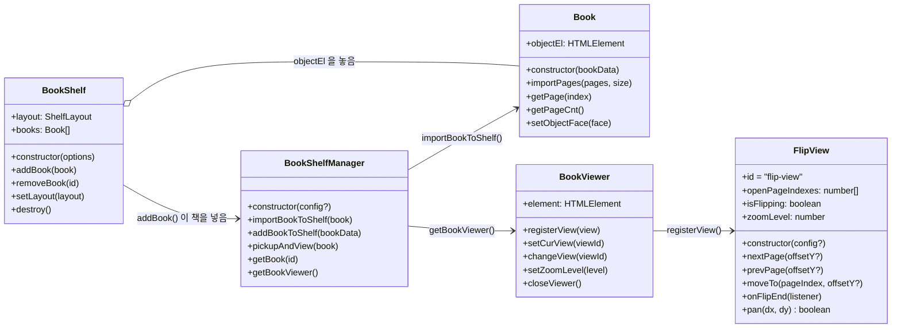

# API 레퍼런스

사용자가 직접 호출하는 공개 API만 정리했습니다.



## BookShelfManager

`@magflip/core`

```ts
new BookShelfManager(config?: IBookShelfManagerConfig)
```

열 수 있는 책들을 들고 있다가 뷰어로 엽니다. **책을 화면에 늘어놓지는 않습니다** — 그 일은 [`BookShelf`](#bookshelf) 나 앱이 합니다.

| config | 타입 | 기본값 | 설명 |
| --- | --- | --- | --- |
| `animateBook` | `boolean` | `true` | 책을 열 때 놓여 있던 자리(`book.objectEl`)에서 뷰어로 날아가고, 닫을 때 돌아갑니다. 동작 줄이기를 켠 독자에게는 날아가지 않습니다. |
| `onViewerClose` | `() => void` | – | 뷰어가 닫힌 뒤 호출됩니다. |
| `onViewerOpen` | `(book: Book) => void` | – | 뷰어가 책을 연 뒤 호출됩니다. 페이지가 생긴 시점이라 [키 입력 연결](../guides/remote-control.md#붙이기)을 여기서 합니다. |
| `hideBookShelf` | `boolean` | – | **폐기.** core 는 더 이상 책장을 그리지 않아 아무 일도 하지 않습니다. |

| 메서드 | 설명 |
| --- | --- |
| `importBookToShelf(book: Book)` | 책을 매니저에 넣습니다. 그 뒤로 책의 `objectEl` 을 누르면 열립니다. 같은 책을 다시 넣으면 무시합니다. |
| `addBookToShelf(data: IBookData)` | 데이터로 `Book` 을 만들어 넣고, 만든 `Book` 을 반환합니다. |
| `pickupAndView(book: Book)` | 책을 뷰어로 엽니다(앞표지부터). `objectEl` 이 화면에 있으면 거기서 날아옵니다. 이미 열려 있으면 무시합니다. |
| `returnBookToShelf(book, from?)` | 책을 제자리로 되돌립니다. 보통 `closeViewer` 가 뷰어의 닫힌 책 위치(`from`)와 함께 호출합니다. |
| `getBook(id)` | 넣어 둔 `Book` 을 id 로 찾습니다. |
| `getBookViewer()` | `BookViewer` 인스턴스를 반환합니다. |
| `animatesBooks` | 지금 책이 날아가는지(`animateBook` 이고 동작 줄이기가 꺼져 있을 때 `true`). |
| `getBookHolder(id)` | **폐기.** 책의 `objectEl` 이 놓인 부모 요소를 반환합니다. |

## BookViewer

`@magflip/core` · `shelfManager.getBookViewer()` 로 얻습니다.

| 멤버 | 설명 |
| --- | --- |
| `element` | `#bookViewer` 요소 |
| `registerView(view: IBookView)` | 뷰 플러그인을 등록합니다. 처음 등록한 뷰가 기본 뷰가 됩니다. |
| `setCurView(viewId)` / `changeView(viewId)` | 사용할 뷰를 선택합니다. |
| `setZoomLevel(level: number)` | 줌 배율을 설정합니다. |
| `closeViewer()` | 뷰어를 닫고 책을 제자리로 되돌립니다. 책이 날아가는 동안 뷰어는 흐려지며 사라집니다. |
| `getClosedBookPlace()` | 지금 뷰가 닫힌 책을 보여 주는(또는 지금 닫으면 놓일) 위치와 보이는 면. 책이 없거나 뷰가 지원하지 않으면 `undefined`. |

## Book

`@magflip/core`

| 멤버 | 설명 |
| --- | --- |
| `new Book(data: IBookData)` | [책 옵션](../guides/book-and-pages.md#book-옵션) 참고 |
| `importPages(pages: IPageData[], size: ISize)` | 페이지들을 추가하고 한 쪽 페이지 크기를 설정합니다. |
| `getPage(index)` | 페이지 객체를 반환합니다. |
| `getPageCnt()` | 로드된 페이지 수를 반환합니다. |
| `size.closed` / `size.opened` | 닫힌/펼친 책 크기 (`width`, `height`, `diagonal`) |
| `objectEl` | 닫힌 책을 밖에서 본 모습(책 객체). 표지·제목이 적힌 책등·두께를 가진 3D 상자이고, 처음 요구할 때 만들어집니다. [책 고르기](../guides/bookshelf.mdx) |
| `hasObjectEl` | `objectEl` 이 만들어졌는지. |
| `objectFace` / `setObjectFace(face: BookFace)` | 책 객체가 보여 주는 면. 제자리에서 돌아 새 면을 보여 줍니다. |
| `setObjectPickedUp(isPickedUp)` | 책이 뷰어에 있는 동안 자리를 비워 둡니다(매니저가 부릅니다). 돌아올 때 키보드 포커스도 되돌립니다. |
| `getObjectPlace()` | 책 객체가 화면에 그려진 위치와 보이는 면. 화면에 없으면 `undefined`. |
| `elementOnShelf` | **폐기.** `objectEl` 을 쓰세요. |

책 객체를 누르면(클릭, `Enter`, `Space`) `BookEvent.objectActivated` 가 발생하고, 책이 들어 있는 `BookShelfManager` 가 그 책을 엽니다.

## BookShelf

`@magflip/shelf` · 여러 권을 격자나 책장으로 늘어놓습니다. 사용법은 [책 고르기](../guides/bookshelf.mdx).

```ts
new BookShelf(options: IBookShelfOptions)
```

| options | 기본값 | 설명 |
| --- | --- | --- |
| `manager` | – | 책을 여는 `BookShelfManager`. 필수. `addBook` 한 책은 여기에도 들어갑니다 |
| `element` | `#bookShelf` | 책을 놓을 요소. 없으면 `id="bookShelf"` 요소를 `body` 끝에 만듭니다 |
| `layout` | `ShelfLayout.Grid` | 처음 배치 |

| 멤버 | 설명 |
| --- | --- |
| `addBook(book)` | 책을 끝에 놓고 매니저에 넣습니다. 이미 있는 책이면 무시합니다. 책장에서의 높이가 판형을 따르므로 `importPages` 뒤에 부르세요 |
| `removeBook(id)` | 책을 내립니다. 매니저는 여전히 그 책을 열 수 있습니다 |
| `setLayout(layout)` / `layout` | 배치를 바꿉니다 / 지금 배치 |
| `books` | 놓인 책들 (놓은 순서) |
| `destroy()` | 책을 모두 내리고, 직접 만든 요소면 요소도 지웁니다 |

## FlipView

`@magflip/flipview`

```ts
new FlipView(config?: IFlipViewConfig)
```

| config | 기본값 | 설명 |
| --- | --- | --- |
| `autoFlip.duration` | `500` | `nextPage` / `prevPage` / `moveTo` 가 한 번 넘기는 시간(ms) |
| `autoFlip.forward.offsetY` | `100` | `nextPage` 곡선 높이(px) |
| `autoFlip.backward.offsetY` | `-100` | `prevPage` 곡선 높이(px) |

| 메서드 | 설명 |
| --- | --- |
| `nextPage(offsetY?)` | 다음 펼침으로 넘깁니다. 마지막이면 무시합니다. |
| `prevPage(offsetY?)` | 이전 펼침으로 넘깁니다. 처음이면 무시합니다. |
| `moveTo(pageIndex, offsetY?)` | 해당 페이지가 보이는 펼침으로 이동합니다. |
| `openPageIndexes` | 지금 보고 있는 페이지 index 배열. 펼침이면 2개, 표지면 1개, 책이 없으면 빈 배열입니다. |
| `isFlipping` | 페이지를 드래그하거나 넘기는 중이면 `true`. 이때 `nextPage` / `prevPage` / `moveTo` 는 무시됩니다. 마우스를 올려 모서리만 들린 상태는 포함하지 않습니다. |
| `onFlipEnd(listener)` | 넘김이나 드래그가 끝나 페이지가 자리 잡을 때마다 `listener` 를 호출합니다. 제자리로 돌아간 드래그도 포함합니다. 리스너를 제거하는 함수를 반환합니다. |
| `zoomLevel` | 지금 배율. 1 이 뷰어에 맞는 크기입니다. |
| `getClosedBookPlace()` | 닫힌 책이 놓인 곳. 펼친 상태면 지금 닫았을 때 놓일 오른쪽 페이지 자리를 앞표지로 반환합니다. 책이 날아올 곳과 날아갈 곳이 여기입니다. |
| `pan(dx, dy)` | 책을 화면 픽셀만큼 옮깁니다. 화면 밖으로는 나가지 않으며, 더 갈 곳이 없으면 `false` 를 반환합니다. [줌과 화면 이동](../guides/viewer-control.md#줌과-화면-이동) |

## PublishedBookSource

`@magflip/render`

게시된 책(`@magflip/doc` 로 만든 JSON)을 불러와 뷰어가 쓸 페이지로 바꿉니다.

```ts
const source = await PublishedBookSource.load('/books/sample/book.json');
const book = new Book({ id: source.manifest.bookId, lastPageIndex: source.pageCount - 1 });
book.importPages(await source.createAllPageData(), source.manifest.pageSize);
```

| 멤버 | 설명 |
| --- | --- |
| `PublishedBookSource.load(manifestUrl, options?)` | 매니페스트(`book.json`)를 읽습니다. |
| `manifest` | 게시본 매니페스트(`IPublishedBook`). |
| `pageCount` / `getPage(index)` | 페이지 수 / 해당 페이지 정보. |
| `loadPages(startIndex, count)` | 그 페이지들이 쓰는 surface 를 미리 받습니다. |
| `createAllPageData()` | 모든 페이지를 `Book.importPages` 에 넣을 수 있는 형태로 반환합니다(작은 책용). |
| `createPageData(index)` | 이미 로드된 surface 의 페이지 하나를 반환합니다. |
| `isExpandable(index)` | 독자가 확장해서 볼 수 있는 페이지인지 여부. |
| `renderExpanded(hostEl, index)` | 페이지의 확장 영역 전체를 그립니다. |

| options | 설명 |
| --- | --- |
| `onPageLink(link)` | 페이지 안의 링크를 눌렀을 때 호출됩니다. `link.surfaceId` 로 이동할 페이지를 찾습니다. |
| `onUrlLink(link)` | 바깥 주소로 가는 링크를 눌렀을 때 호출되고, **페이지는 그 주소로 이동하지 않습니다**. 설정하지 않으면 브라우저가 평소대로 링크를 따라갑니다. 앱으로 포장해 다른 페이지로 나갈 수 없는 곳(TV 앱 등)에서 씁니다. |
| `isInteractive` | `false` 면 링크·미디어가 반응하지 않습니다(에디터 캔버스용). |
| `resolveWidgetUrl(element)` | 위젯 iframe 의 URL 을 반환합니다. 설정하지 않으면 게시본에 적힌 `url` 을 씁니다. |
| `resolveSurfaceUrl(surfaceId)` | surface JSON 의 위치. 기본값은 `<매니페스트 폴더>/surfaces/<id>.json` 입니다. |

## RemoteController

`@magflip/input` · 키보드·리모컨 입력을 책 조작으로 바꿉니다. 사용법은 [리모컨·키보드로 읽기](../guides/remote-control.md).

```ts
new RemoteController(options)
```

| options | 설명 |
| --- | --- |
| `view` | 조작할 뷰 (`IBookView`). 필수 |
| `getPageContentEl(index)` | 그 페이지가 그려진 요소. 아직 그려지지 않았으면 `undefined`. 필수 |
| `onBack()` | 페이지 보기에서 뒤로가기를 눌렀을 때. 뷰어를 닫을지 앱을 닫을지는 호스트가 정합니다 |
| `onModeChange(mode)` | `'page'` ↔ `'element'` 전환 시 |
| `keyMap` / `keyCodeMap` | 키 이름 / 키 번호를 동작으로. 기본값에 덮어씁니다 |
| `focusSelector` | 고를 수 있는 요소의 선택자. 기본은 링크·동영상·음악·위젯 |
| `panStep` | 방향키 한 번에 움직이는 거리(px). 기본 `120` |
| `flipQueueLimit` | 넘기는 중에 기억할 요청 수. 기본 `1` |
| `zoom` | `ZoomIn`/`ZoomOut` 의 `min`·`max`·`step`. 기본 `1`·`3`·`0.25` |
| `target` | 키를 들을 대상. 기본 `document` |

| 멤버 | 설명 |
| --- | --- |
| `dispatch(action)` | 키 없이 동작 실행. 앱이 가로챈 키(Android TV 뒤로가기)를 넘길 때 씁니다. 사용했으면 `true` |
| `navigator` | `BookNavigator` — `mode`, `focusedElement`, `enterElementMode()`, `leaveElementMode()`, `handle(action)` |
| `destroy()` | 리스너 해제. 뷰어를 닫을 때 부르세요 |

| `InputAction` | 뜻 |
| --- | --- |
| `Left` `Right` `Up` `Down` | 방향 |
| `Ok` / `Back` | 고르기·사용 / 되돌아가기 |
| `PageNext` / `PagePrev` | 모드와 무관하게 한 장 넘김 |
| `PlayPause` | 고른 동영상·음악 재생·정지 |
| `ZoomIn` / `ZoomOut` | 확대 / 축소 |

## Enum

| Enum | 값 |
| --- | --- |
| `BookType` | `Book`, `Magazine`, `Newspaper` |
| `BookCover` | `Soft`, `Hard` — 표지 재질. [하드커버](../guides/book-and-pages.md#하드커버) |
| `BookFace` | `Front`, `Spine`, `Back` — 닫힌 책의 면 |
| `ShelfLayout` (`@magflip/shelf`) | `Grid`, `Shelf` |
| `PageType` | `Page`, `Cover`, `Empty`, `Blank` |
| `PageLabelType` | `Default`, `Empty` |
