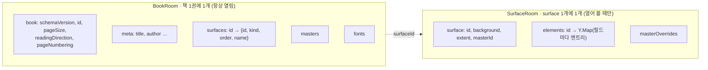
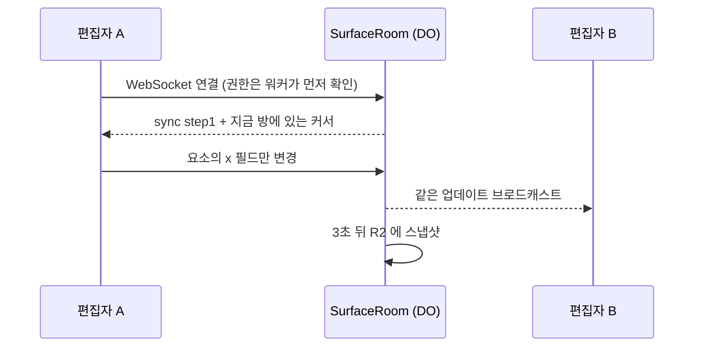

# 동시 편집 (Yjs)

여러 명이 같은 책을 동시에 편집합니다. 충돌 해결은 CRDT(Yjs)가 맡고, `@magflip/doc/yjs` 는 **문서 모델을 Yjs 구조에 어떻게 얹을지**를 정합니다.

## 방 나누기



BookRoom 에는 요소가 없습니다. 수천 페이지 책에서도 매니페스트는 수백 KB 안쪽이라 편집 내내 열어 둘 수 있고, 실제 내용은 보고 있는 surface 만 열면 됩니다. Durable Object 인스턴스의 메모리 한계(128MB)를 넘지 않기 위한 구조이기도 합니다.

## 병합 규칙

### 면 자체의 설정도 필드 단위다

배경, 확장 영역(`extent`), 적용한 마스터는 `surface` 맵의 개별 엔트리입니다. `setSurfaceSetting(ydoc, 'extent', …)` 은 그 키 하나만 씁니다 — 한 사람이 확장 영역을 넓히는 동안 다른 사람이 마스터를 고르면 둘 다 남습니다.

### 요소는 필드 단위로 저장한다

요소 하나가 `Y.Map` 하나이고, `x`, `width`, `fill` 같은 필드가 각각 엔트리입니다. 그래서 **A 가 옮기고 B 가 크기를 바꾸면 둘 다 남습니다.**

```ts
patchElement(ydoc, 'box', { x: 250 });    // A
patchElement(ydoc, 'box', { width: 400 }); // B
// 동기화 후 → { x: 250, width: 400 }
```

요소 전체를 JSON 값 하나로 저장하면 이 경우 한쪽이 통째로 사라집니다. 그래서 `writeElement` 는 필드를 하나씩 씁니다.

### 순서는 fractional index 로 저장한다

페이지 순서와 요소의 z-order 는 배열이 아니라 `order` 문자열입니다.

| 동작 | 배열이라면 | fractional index |
| --- | --- | --- |
| 페이지 이동 | 삭제 + 삽입 → 동시 이동 시 복제 | `order` 필드만 덮어씀 → 나중 값이 이김 |
| 같은 자리에 동시 삽입 | 순서 불확정 | 같은 키가 나오면 `id` 로 결정 (모든 클라이언트 동일) |

### 리치 텍스트는 Yjs 델타로 저장한다

텍스트 요소의 `content` 는 `Y.XmlFragment` 입니다. 문단은 `Y.XmlElement('paragraph')`, 글자는 `Y.XmlText` 이고 마크는 서식 속성으로 붙습니다. 필드는 `Y.XmlElement('field')` 라는 별도 노드입니다.

덕분에 두 사람이 같은 문단에 동시에 입력해도 글자 단위로 병합됩니다. 에디터의 리치 텍스트 편집기는 `getTextFragment(ydoc, elementId)` 로 이 fragment 에 직접 바인딩합니다 — 문서가 곧 편집기의 상태이고, 키를 누를 때마다 텍스트를 통째로 다시 쓰지 않습니다.

마크 하나가 속성 하나이고, 값은 이런 모양입니다.

```
"loud" → { fontWeight: { value: 700 }, isItalic: {} }
```

켜고 끄는 마크(`isItalic`, `isUnderlined`, `isStruckThrough`)는 빈 객체, 나머지는 `value` 안에 값을 둡니다. **ProseMirror 마크가 Yjs 문서에 저장되는 모양**이 이것이고(`y-prosemirror`), 그래서 편집기가 이 fragment 에 그대로 붙습니다. 모델의 `ITextMarks`(평평한 `{ fontWeight: 700 }`)와 이 모양 사이의 번역은 `collab/textYXml.ts` 의 `toMarkAttributes` / `toTextMarks` 한 쌍이 맡습니다.

:::note
편집기의 스키마는 마크 이름을 `MARK_NAMES` 에서 가져옵니다. 이름이 어긋나면 한쪽이 쓴 서식을 다른 쪽이 다른 마크로 읽습니다.
:::

## 깨진 상태는 읽을 때 고친다

CRDT 는 "두 변경을 모두 살리는" 것이 목적이라, 의미상 불가능한 상태가 만들어질 수 있습니다. 예를 들어 A 가 그룹 1을 그룹 2에 넣고, 동시에 B 가 그룹 2를 그룹 1에 넣으면 순환이 생깁니다.

이런 상태는 **쓰기를 막는 대신 읽을 때 같은 규칙으로 복구**합니다([요소와 텍스트](./elements-and-text.md#z-order-와-그룹)의 표). 모든 클라이언트가 같은 입력에서 같은 트리를 만들기 때문에 화면이 갈라지지 않고, 문제는 `IDocProblem` 으로 보고되어 에디터가 알려줄 수 있습니다.

## 구현된 모습 (magFlipServer · MagFlipEditor)



- 서버는 `YjsRoom` 하나로 두 방을 만든다. WebSocket 은 hibernation 으로 받고, 마지막 변경 3초 뒤 R2 에 스냅샷을 쓴다.
- 권한은 워커에서 확인한다. 방은 누가 연결했는지 모르고 문서만 합친다.
- 편집기는 `applyElements` 로 **바뀐 필드만** 쓴다. 한 명이 옮기고 한 명이 크기를 바꿔도 둘 다 남는 이유다.
- 실행 취소는 `Y.UndoManager` 에 `trackedOrigins` 를 걸어 **자기 변경만** 되돌린다.
- awareness(선택·이름·색)는 문서에 저장하지 않는다. 연결이 끊기면 그 사람의 표시는 사라진다.

### 브라우저에서 걸리는 것들

- WebSocket 핸드셰이크에는 헤더를 붙일 수 없다 → 사용자는 쿼리스트링으로 보낸다(개발용 `?devUser=`, 실서비스에서는 짧은 수명의 토큰).
- 클라이언트는 `binaryType = 'arraybuffer'` 를 설정해야 한다. 기본값(Blob)이면 메시지를 해석하지 못한다.
- 조용한 방은 잠들어 있어야 하므로, 연결 확인은 텍스트 `ping` 으로 하고 런타임이 `pong` 을 대신 답한다(`setWebSocketAutoResponse`).
