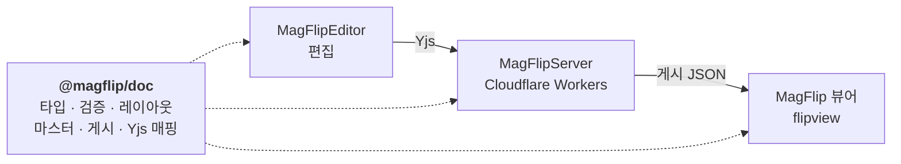
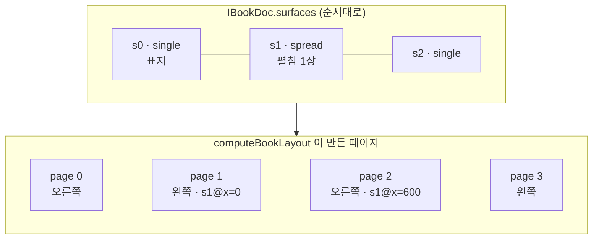

# 문서 모델 개요

`@magflip/doc` 는 **MagFlipEditor · MagFlipServer · MagFlip 뷰어가 공유하는 책 데이터 형식**입니다.
편집기에서 만든 책이 서버를 거쳐 뷰어에서 같은 모습으로 보이려면, 세 곳이 같은 타입과 같은 규칙을 써야 합니다. 그 규칙을 한 패키지에 모았습니다.



## 다섯 가지 개념

| 개념 | 무엇인가 | 타입 |
| --- | --- | --- |
| **Book** | 책 한 권의 매니페스트. 페이지 순서, 마스터 목록, 폰트. 요소는 들어 있지 않다 | `IBookDoc` |
| **Surface** | 요소가 놓이는 편집 단위. 1페이지(`single`) 또는 펼친 2페이지(`spread`) | `ISurfaceDoc` |
| **Page** | 독자가 보는 한 면. Surface 를 자른 창(window)이며, 순서에서 계산된다 | `IPageSlot` |
| **Element** | 이미지·텍스트·도형·동영상·오디오·위젯·그룹 | `IElement` |
| **Master** | 여러 페이지 밑에 깔리는 surface (쪽번호, 머리글) | `ISurfaceDoc` + `IMasterRef` |

핵심은 **Surface 와 Page 를 분리**한 것입니다. 펼친 두 페이지에 하나의 이미지를 얹으려면 그 두 페이지가 **한 장의 캔버스**여야 하고, 반대로 페이지는 넘김·썸네일·쪽번호의 단위여야 합니다. 그래서 요소는 Surface 에 속하고, Page 는 Surface 를 왼쪽/오른쪽으로 잘라 본 것입니다.



## 편집본과 게시본

같은 책이 두 가지 형태로 존재합니다.

| | 편집본 | 게시본 |
| --- | --- | --- |
| 저장 | Yjs 문서 (BookRoom / SurfaceRoom) | R2 의 JSON 파일 |
| 타입 | `IBookDoc`, `ISurfaceDoc`, `IElement` | `IPublishedBook`, `IPublishedSurface`, `IPublishedNode` |
| 내용 | 숨긴 요소, pasteboard, 마스터 참조, 편집용 필드 포함 | 독자가 볼 것만. 마스터는 이미 합쳐져 있고 쪽번호도 채워져 있음 |
| 읽는 쪽 | 에디터, 서버 | 뷰어 |

게시본을 따로 두는 이유는 두 가지입니다. 뷰어가 마스터 해석·트리 구성 같은 계산을 하지 않아도 되고, **독자에게 감춰야 할 내용을 데이터에서 아예 빼버릴 수 있기** 때문입니다. 자세한 내용은 [게시 파이프라인](./publishing.md)에 있습니다.

## 저장 위치


책 전체를 Yjs 문서 하나에 담지 않는 이유는 Durable Object 인스턴스의 메모리 한계(128MB) 때문입니다. 수천 페이지짜리 책도 **보고 있는 surface 만** 열면 되도록 방을 나눴습니다. 이 구조는 무한 캔버스의 지연 로딩 전략과 그대로 맞물립니다.

## 패키지 진입점

```ts
// 모델, 스키마, 레이아웃, 게시, 검증
import { computeBookLayout, publishSurface, validateBookBundle } from '@magflip/doc';

// 협업 매핑 (에디터·서버 전용, 뷰어는 import 하지 않는다)
import { writeSurfaceDoc, readSurfaceDoc, patchElement } from '@magflip/doc/yjs';
```

Yjs 를 별도 진입점으로 나눈 이유는 뷰어 번들에 협업 라이브러리가 섞여 들어가지 않게 하기 위해서입니다.

## 다음 문서

- [Surface 와 페이지](./surface-and-pages.md) — 좌표계, 펼침 규칙, 확장 영역
- [요소와 텍스트](./elements-and-text.md) — 요소 타입, 그룹, 리치 텍스트, 마스터
- [동시 편집](./collaboration.md) — Yjs 매핑과 병합 규칙
- [게시와 검증](./publishing.md) — 게시 파이프라인, 문제 코드, 마이그레이션
