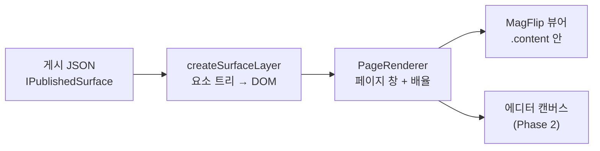

# 렌더러 (@magflip/render)

게시된 surface 를 **DOM 으로 그리는 단 하나의 코드**입니다. 뷰어와 에디터가 같은 함수를 쓰므로, 편집 화면과 독자가 보는 화면이 어긋날 수 없습니다.



## 두 개의 층

| 함수 | 하는 일 |
| --- | --- |
| `createSurfaceLayer(surface, options)` | surface 하나를 DOM 으로 만든다. 층의 크기는 `visibleRect` 이고, 요소는 surface 좌표에서 그 원점을 뺀 위치에 놓인다. |
| `PageRenderer` | 그 층에서 **한 페이지만 보이도록 잘라내고**, 문서 px 를 화면 px 로 맞춘다. |

`PageRenderer` 가 배율을 담당하는 이유는, 문서가 설계된 크기(예: 600×900)와 뷰어가 보여주는 크기(줌·창 크기에 따라 달라짐)가 다르기 때문입니다. 호스트 요소의 크기 변화는 `ResizeObserver` 로 따라갑니다.

```ts
const renderer = new PageRenderer(contentEl);
renderer.renderPage({ surface, surfaceX: 600, pageSize });  // 펼침의 오른쪽 페이지
renderer.renderExpanded(surface);                            // 확장 보기
```

펼침의 오른쪽 페이지는 같은 층을 `translate(-600px)` 한 것뿐입니다. 그래서 두 페이지에 걸친 이미지가 잘린 두 조각이 아니라 하나의 요소로 남습니다.

## 요소별 렌더링

| 타입 | 만드는 DOM | 주의한 점 |
| --- | --- | --- |
| image | `` | crop 이 있으면 `object-fit` 대신 `getImagePlacement` 가 계산한 위치로 이미지를 확대·이동한다. 편집기의 자르기 화면과 같은 함수다 |
| text | `<p>` + `<span>` | **항상 `textContent`**. 문서 내용이 마크업으로 해석되지 않는다. 목록 항목은 `.mf-text-li` 에 `data-mf-marker`(번호·기호)와 `--mf-list-level` 을 달고, 기호는 `::before` 로 그린다 |
| shape | `<svg>` | 박스 크기의 viewBox. 그라디언트는 SVG `defs` 로 |
| video / audio | `<video>` / `<audio>` | 에디터 캔버스(`isInteractive: false`)에서는 재생하지 않는다 |
| widget | `<iframe sandbox>` | `allow-same-origin` 을 주지 않는다. props 는 로드 후 `postMessage` 로, 위젯 URL 의 origin 에만 보낸다 |
| group | `<div>` | 좌표계를 만들지 않는다. 자식은 surface 좌표 그대로 |

링크는 `<a>` 로 감싸고, URL 은 그릴 때 `isSafeUrl` 로 한 번 더 확인합니다(스키마에서 이미 걸렀더라도, 편집 중인 문서를 그릴 때가 있기 때문입니다). 페이지 링크는 이동을 직접 하지 않고 `onPageLink` 로 알려서, 어떤 뷰어를 쓰든 그 뷰어 방식대로 이동하게 합니다.

## 뷰어 연결

core 는 다른 MagFlip 패키지를 import 하지 않으므로, 렌더러를 직접 부르지 않습니다. 대신 페이지 데이터가 **자기 자신을 그리는 함수**를 들고 옵니다.

```ts
// @magflip/core 의 IPageData
render?: (contentEl: HTMLElement) => void;
```

`PublishedBookSource.createPageData(index)` 가 이 함수를 채워 주고, `PageEl` 은 `content`/`image` 대신 그것을 호출합니다. 덕분에 core 는 게시 형식을 몰라도 되고, 기존 이미지 기반 책도 그대로 동작합니다.

```ts
const source = await PublishedBookSource.load('./sample-book/book.json', {
  onPageLink: link => flipView.moveTo(indexOfSurface(link.surfaceId)),
});
book.importPages(source.createPageDataList(), source.manifest.pageSize);
```

`createPageDataList()` 는 **아무것도 받아 오지 않습니다.** 페이지는 처음 그려질 때 자기 surface 를 가져오고, core 의 페이지 요소도 뷰어가 그 페이지를 보여줄 때 만들어집니다. 그래서 300쪽 책을 열 때 나가는 요청은 매니페스트 하나뿐이고, 한 번 펼치면 그 창(6쪽)만 받아 옵니다.

한 번 받은 surface 는 캐시합니다. 같은 surface 를 두 페이지가 동시에 요구해도 요청은 한 번만 나갑니다. 책 전체를 미리 받아 두고 싶을 때만 `await source.createAllPageData()` 를 씁니다.

## 확장 보기

`isExpandable` 인 페이지는 `renderExpanded` 로 extent 전체를 보여줍니다. 확장이 허용되지 않은 페이지는 **게시본에 그 내용이 아예 없으므로**, 뷰어가 확장하려 해도 보여줄 것이 없습니다([게시와 검증](./publishing.md)).

로컬 예제(`docs/examples/local`)의 네 번째 책이 이 경로 전체를 보여 줍니다: 펼침 이미지, 마스터 쪽번호, 페이지 링크, 확장 버튼.

```bash
npm run sample:book   # 샘플 게시본 다시 만들기
npm run dev           # 빌드 후 http://localhost:8080/docs/examples/local/
```
