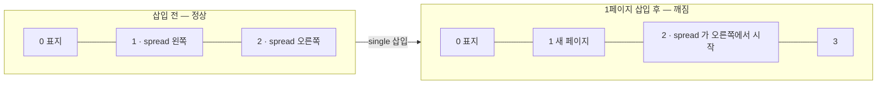
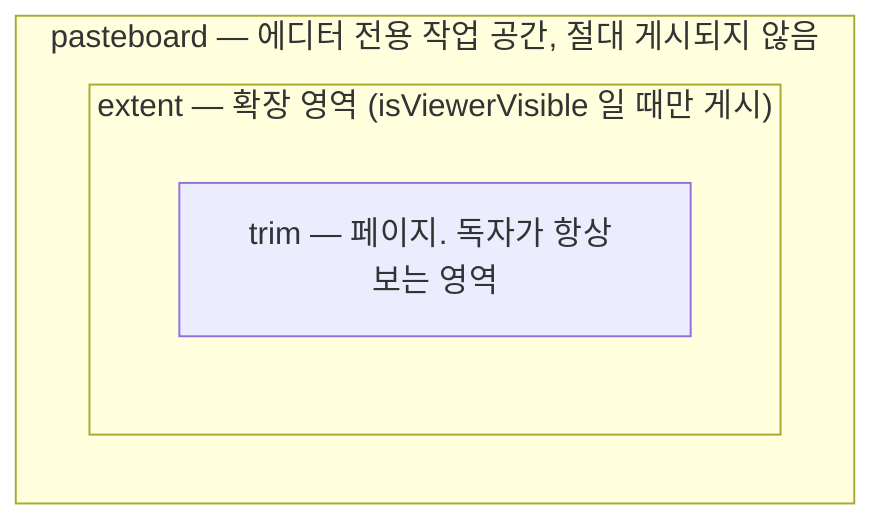

# Surface 와 페이지

## 좌표계

단위는 CSS px(줌 1 기준)이고, 원점은 surface 의 왼쪽 위입니다. x 는 오른쪽, y 는 아래가 양수입니다.

| kind | 크기 | 페이지 위치 |
| --- | --- | --- |
| `single` | `pageSize` | x = 0 |
| `spread` | `pageSize.width × 2` | 왼쪽 페이지 x = 0, 오른쪽 페이지 x = `pageSize.width` |

페이지 크기는 책 전체에서 하나입니다(`IBookDoc.pageSize`). 덕분에 페이지 index 만으로 격자 좌표가 나오고, 무한 캔버스에서 보이는 페이지를 계산하는 비용이 O(1) 이 됩니다.

**펼침 이미지**는 spread surface 위에 폭 `1200`(=600×2)짜리 이미지 요소 하나를 놓은 것입니다. 요소를 페이지별로 쪼개지 않으므로, 이미지 하나를 올리는 것과 완전히 같은 조작이 됩니다. 뷰어는 각 페이지를 그릴 때 surface 를 해당 창(window)으로 잘라서 보여줍니다.

## 페이지 index 와 좌우

`computeBookLayout(book)` 이 surface 순서를 훑어 페이지를 만듭니다.

- 표지(index 0)는 혼자 오른쪽에 섭니다. 그래서 **짝수 = 오른쪽, 홀수 = 왼쪽**이고 펼침 쌍은 (1,2), (3,4) … 입니다. (`getPageSide`, `getFacingPageIndex`)
- `readingDirection: 'rtl'` 이면 좌우가 통째로 뒤집힙니다. 쌍은 그대로이고, 먼저 읽는 페이지가 오른쪽에 옵니다.
- 쪽번호는 `pageNumbering` 이 정합니다. `firstNumberedPageIndex` 이전 페이지는 `number: null` 이라 쪽번호를 표시하지 않습니다.

## 펼침 정렬 문제

펼침은 **홀수 index 에서 시작**해야 합니다. 그런데 앞에 단일 페이지를 한 장 끼워 넣으면 뒤쪽 펼침이 한 칸씩 밀려 왼쪽/오른쪽이 뒤집힙니다.

이건 데이터 구조로는 피할 수 없어서, **검출해서 알려주는 방식**을 택했습니다.

- `computeBookLayout` 이 `SpreadMisaligned` 문제를 **에러**로 보고합니다.
- 에디터는 이 에러가 있는 책을 게시하지 못하게 막고, "빈 페이지 한 장 추가" 같은 해결책을 제시합니다.
- 에디터 UX 권장: 펼침 앞뒤로는 2장 단위 삽입을 기본으로 한다.

## trim · extent · pasteboard

한 surface 에는 세 겹의 영역이 있습니다.

- `extent: null` 이면 surface 는 페이지 크기 그대로입니다.
- `extent.rect` 는 반드시 trim 을 포함해야 합니다(어기면 `ExtentExcludesTrim` 경고, 게시 시 자동으로 합집합 처리).
- **`isViewerVisible: false`** 면 독자는 확장할 수 없고, 게시할 때 trim 밖 요소가 **파일에서 제거**됩니다. CSS 로 숨기는 것이 아니므로 개발자 도구로도 볼 수 없습니다.
- `isViewerVisible: true` 면 게시본에 `isExpandable: true` 와 `visibleRect` 가 담기고, 뷰어는 확장 버튼을 띄울 수 있습니다.

extent 를 명시적인 사각형으로 둔 이유는, 요소 위치에서 자동 계산하면 "잠깐 옆에 빼둔 이미지" 때문에 확장 영역이 멋대로 커지기 때문입니다. 그런 임시 요소를 두는 자리가 pasteboard 입니다.

## 관련 코드

| 하는 일 | 함수 |
| --- | --- |
| 순서 → 페이지 | `computeBookLayout(book)` |
| 페이지의 좌우 | `getPageSide(index, direction)` |
| 마주보는 페이지 | `getFacingPageIndex(index, pageCount)` |
| surface·페이지 사각형 | `getSurfaceTrimRect`, `getPageTrimRect`, `getVisibleRect` |
| 펼침 시작 가능 여부 | `canSpreadStartAt(index)` |
