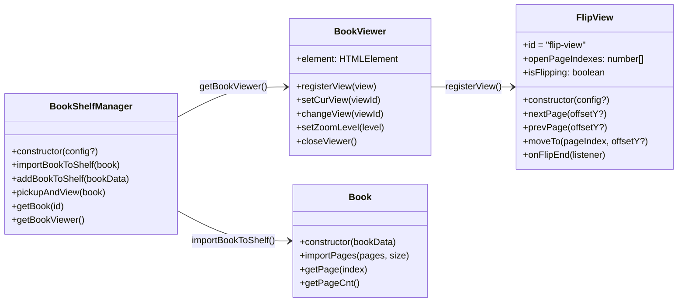

# API 레퍼런스

사용자가 직접 호출하는 공개 API만 정리했습니다.



## BookShelfManager

`@magflip/core`

```ts
new BookShelfManager(config?: IBookShelfManagerConfig)
```

| config | 타입 | 기본값 | 설명 |
| --- | --- | --- | --- |
| `hideBookShelf` | `boolean` | `false` | 책장(`#bookShelf`)을 숨깁니다. |
| `onViewerClose` | `() => void` | – | 뷰어가 닫힌 뒤 호출됩니다. |

| 메서드 | 설명 |
| --- | --- |
| `importBookToShelf(book: Book)` | 생성한 `Book` 을 책장에 추가합니다. |
| `addBookToShelf(data: IBookData)` | 데이터로 `Book` 을 만들어 책장에 추가합니다. |
| `pickupAndView(book: Book)` | 책을 뷰어로 엽니다. 이미 열려 있으면 무시합니다. |
| `returnBookToShelf(book)` | 책을 책장으로 되돌립니다. (보통 `closeViewer` 가 호출) |
| `getBook(id)` | 책장에 있는 `Book` 을 id로 찾습니다. |
| `getBookViewer()` | `BookViewer` 인스턴스를 반환합니다. |

## BookViewer

`@magflip/core` · `shelfManager.getBookViewer()` 로 얻습니다.

| 멤버 | 설명 |
| --- | --- |
| `element` | `#bookViewer` 요소 |
| `registerView(view: IBookView)` | 뷰 플러그인을 등록합니다. 처음 등록한 뷰가 기본 뷰가 됩니다. |
| `setCurView(viewId)` / `changeView(viewId)` | 사용할 뷰를 선택합니다. |
| `setZoomLevel(level: number)` | 줌 배율을 설정합니다. |
| `closeViewer()` | 뷰어를 닫고 책을 책장으로 되돌립니다. |

## Book

`@magflip/core`

| 멤버 | 설명 |
| --- | --- |
| `new Book(data: IBookData)` | [책 옵션](../guides/book-and-pages.md#book-옵션) 참고 |
| `importPages(pages: IPageData[], size: ISize)` | 페이지들을 추가하고 한 쪽 페이지 크기를 설정합니다. |
| `getPage(index)` | 페이지 객체를 반환합니다. |
| `getPageCnt()` | 로드된 페이지 수를 반환합니다. |
| `size.closed` / `size.opened` | 닫힌/펼친 책 크기 (`width`, `height`, `diagonal`) |

## FlipView

`@magflip/flipview`

```ts
new FlipView(config?: IFlipViewConfig)
```

| config | 기본값 | 설명 |
| --- | --- | --- |
| `autoFlip.duration` | `500` | `nextPage` / `prevPage` / `moveTo` 가 한 번 넘기는 시간(ms) |
| `autoFlip.forward.offsetY` | `100` | `nextPage` 곡선 높이(px) |
| `autoFlip.backward.offsetY` | `-100` | `prevPage` 곡선 높이(px) |

| 메서드 | 설명 |
| --- | --- |
| `nextPage(offsetY?)` | 다음 펼침으로 넘깁니다. 마지막이면 무시합니다. |
| `prevPage(offsetY?)` | 이전 펼침으로 넘깁니다. 처음이면 무시합니다. |
| `moveTo(pageIndex, offsetY?)` | 해당 페이지가 보이는 펼침으로 이동합니다. |
| `openPageIndexes` | 지금 보고 있는 페이지 index 배열. 펼침이면 2개, 표지면 1개, 책이 없으면 빈 배열입니다. |
| `isFlipping` | 페이지를 드래그하거나 넘기는 중이면 `true`. 이때 `nextPage` / `prevPage` / `moveTo` 는 무시됩니다. 마우스를 올려 모서리만 들린 상태는 포함하지 않습니다. |
| `onFlipEnd(listener)` | 넘김이나 드래그가 끝나 페이지가 자리 잡을 때마다 `listener` 를 호출합니다. 제자리로 돌아간 드래그도 포함합니다. 리스너를 제거하는 함수를 반환합니다. |

## PublishedBookSource

`@magflip/render`

게시된 책(`@magflip/doc` 로 만든 JSON)을 불러와 뷰어가 쓸 페이지로 바꿉니다.

```ts
const source = await PublishedBookSource.load('/books/sample/book.json');
const book = new Book({ id: source.manifest.bookId, lastPageIndex: source.pageCount - 1 });
book.importPages(await source.createAllPageData(), source.manifest.pageSize);
```

| 멤버 | 설명 |
| --- | --- |
| `PublishedBookSource.load(manifestUrl, options?)` | 매니페스트(`book.json`)를 읽습니다. |
| `manifest` | 게시본 매니페스트(`IPublishedBook`). |
| `pageCount` / `getPage(index)` | 페이지 수 / 해당 페이지 정보. |
| `loadPages(startIndex, count)` | 그 페이지들이 쓰는 surface 를 미리 받습니다. |
| `createAllPageData()` | 모든 페이지를 `Book.importPages` 에 넣을 수 있는 형태로 반환합니다(작은 책용). |
| `createPageData(index)` | 이미 로드된 surface 의 페이지 하나를 반환합니다. |
| `isExpandable(index)` | 독자가 확장해서 볼 수 있는 페이지인지 여부. |
| `renderExpanded(hostEl, index)` | 페이지의 확장 영역 전체를 그립니다. |

| options | 설명 |
| --- | --- |
| `onPageLink(link)` | 페이지 안의 링크를 눌렀을 때 호출됩니다. `link.surfaceId` 로 이동할 페이지를 찾습니다. |
| `isInteractive` | `false` 면 링크·미디어가 반응하지 않습니다(에디터 캔버스용). |
| `resolveWidgetUrl(element)` | 위젯 iframe 의 URL 을 반환합니다. |
| `resolveSurfaceUrl(surfaceId)` | surface JSON 의 위치. 기본값은 `<매니페스트 폴더>/surfaces/<id>.json` 입니다. |

## Enum

| Enum | 값 |
| --- | --- |
| `BookType` | `Book`, `Magazine`, `Newspaper` |
| `PageType` | `Page`, `Cover`, `Empty`, `Blank` |
| `PageLabelType` | `Default`, `Empty` |
